# Investigação 01: Cryptojacking via Coinhive em fórum externo

| | |
| --- | --- |
| **Data do incidente** | 20/08/2018 |
| **Gravidade** | Média (uso indevido de recursos, sem evidência de persistência ou roubo de dados) |
| **Máquinas envolvidas** | BSTOLL-L (minerou), MKRAEUS-L (exposta), BTUN-L (protegida) |
| **Origem** | `www.brewertalk.com` (fórum MyBB externo) servindo o minerador JavaScript do Coinhive |
| **Fontes correlacionadas** | `PerfmonMk:Process`, `stream:dns`, `stream:http`, `syslog`, `symantec:ep:security:file` |
| **MITRE ATT&CK** | [T1189 Drive-by Compromise](https://attack.mitre.org/techniques/T1189/), [T1496 Resource Hijacking](https://attack.mitre.org/techniques/T1496/) |

> **Fuso horário:** os horários estão como exibidos no Splunk, com o usuário configurado em GMT-04:00. Os logs do Symantec registram internamente um horário diferente (ex.: `13:37:40` no log contra `10:37:40` no `_time`). Ao correlacionar, sempre usar o `_time` do Splunk.

## Resumo

Em 20/08/2018, o fórum externo **brewertalk.com** estava servindo o script de mineração de criptomoeda (Monero) do **Coinhive**. Três notebooks da Frothly acessaram o fórum:

| Máquina | Usuário | Navegador | DNS do Coinhive | Antivírus | Resultado |
| --- | --- | --- | --- | --- | --- |
| **BSTOLL-L** | B. Stoll | Chrome | Sim, 10:37 | Nenhuma detecção | 🔴 **Minerou: CPU em ~100% por cerca de 30 minutos** |
| **MKRAEUS-L** | M. Kraeus | Não identificado | Sim, 10:27 | Nenhuma detecção | 🟡 Exposta; sem telemetria de CPU para confirmar mineração |
| **BTUN-L** | BillyTun | Edge | Não | **46 bloqueios** (JSCoinminer) | 🟢 Protegida |

A investigação começou por uma **anomalia de volume de logs** e foi confirmada por **quatro fontes independentes**:

```
Perfmon (CPU)  →  DNS (coinhive)  →  HTTP (brewertalk.com)  →  Symantec (JSCoinminer)
   efeito            contato              origem                   confirmação
```

## Linha do tempo

| Horário | Máquina | Fonte | Evento |
| --- | --- | --- | --- |
| 10:20:37 | BSTOLL-L | DNS | Primeira consulta a `www.brewertalk.com` |
| 10:27:17 | MKRAEUS-L | DNS | **Primeira consulta ao `coinhive.com` no ambiente** |
| 10:30 | BSTOLL-L | Perfmon | CPU do `chrome#4` sobe de ~0% para 22% |
| 10:36:29 | BSTOLL-L | HTTP | Acesso a `www.brewertalk.com/` e `/forumdisplay.php` |
| 10:37:33 | BSTOLL-L | HTTP + DNS | Página inicial do brewertalk carregada e, **no mesmo segundo**, consulta ao `coinhive.com` |
| 10:37:34 – 10:38:38 | BSTOLL-L | DNS | Conexões aos servidores WebSocket `ws001`, `ws005`, `ws011`, `ws014`, `ws019.coinhive.com` |
| 10:37:40 | BTUN-L | Symantec | **Bloqueio**: *Web Attack: JSCoinminer Download*, URL `brewertalk.com/forumdisplay.php?fid=9` |
| 10:40 – 10:50 | BSTOLL-L | Perfmon | CPU do `chrome#4` em **~100%** |
| 10:46:47 | BTUN-L | Symantec | Último bloqueio (46 no total) |
| 11:00 – 11:10 | BSTOLL-L | Perfmon | CPU cai para 48,8% e depois volta ao normal (~1%) |
| 11:05:23 | — | syslog (rede) | Último registro de tráfego para o Coinhive |

## Investigação passo a passo

### Passo 1: inventário das máquinas Windows

**Por quê:** antes de procurar ataque, é preciso saber o que existe no ambiente e qual é o comportamento normal.

```spl
index=botsv3 earliest=0 (sourcetype=WinEventLog OR sourcetype=XmlWinEventLog OR sourcetype=WinHostMon)
| stats count dc(sourcetype) as fontes by host
| sort - count
```

> **Leitura:** procure todos os logs do Windows, agrupe por máquina, conte os eventos e as fontes diferentes de cada uma e ordene da mais barulhenta para a mais quieta.

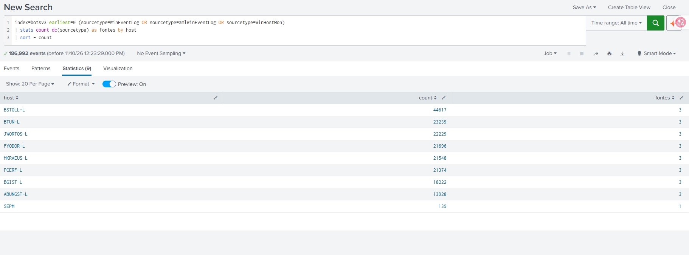

**Achado:** 8 notebooks (sufixo `-L`, padrão inicial + sobrenome) e 1 servidor (`SEPM`, gerenciador do antivírus Symantec, monitorado por apenas 1 fonte). O **BSTOLL-L gera 44.617 eventos**, quase o dobro do segundo colocado (BTUN-L, 23.239). Máquinas parecidas deveriam gerar volumes parecidos: é uma **anomalia**.

### Passo 2: de onde vem o volume extra do BSTOLL-L?

**Por quê:** sabemos *quem* é diferente; falta saber *de onde* vem a diferença. A fonte do excesso indica a direção da investigação.

```spl
index=botsv3 earliest=0 host=BSTOLL-L
| stats count by sourcetype source
| sort - count
```

> **Leitura:** mostre todos os logs da máquina BSTOLL-L, agrupados por tipo e origem, do que mais gerou para o que menos gerou.

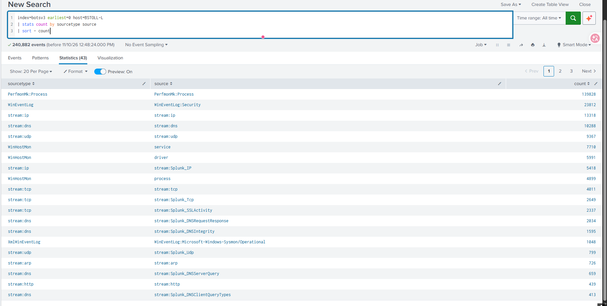

**Achado:** `PerfmonMk:Process` responde por **139.828 eventos**, exatamente o total dessa fonte no dataset inteiro. **Só o BSTOLL-L tem monitoramento de desempenho de processos.** O Sysmon dele tem apenas 1.048 eventos, então o excesso não vem de criação de processos.

### Passo 3: qual processo consome mais CPU?

**Por quê:** se o desempenho desta máquina estava sendo monitorado, a hipótese é que algum processo consumia recurso demais.

```spl
index=botsv3 earliest=0 host=BSTOLL-L sourcetype="PerfmonMk:Process"
| stats avg("%_Processor_Time") as cpu_media max("%_Processor_Time") as cpu_max count by instance
| sort - cpu_media
| head 10
```

> **Leitura:** para cada processo do BSTOLL-L, calcule a CPU média, o pico máximo e o número de medições, e mostre os 10 que mais usaram CPU em média.

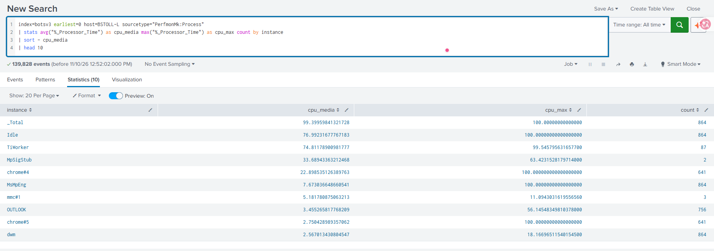

**Achado (triagem):**

| Processo | CPU média | Medições | Veredito |
| --- | --- | --- | --- |
| `_Total` / `Idle` | 99,4% / 77% | 864 | Agregados do sistema, não são processos |
| `TiWorker` | 74,8% | 87 | Legítimo: Windows Update, alto consumo por pouco tempo |
| `MpSigStub` / `MsMpEng` | 33,7% / 7,7% | 2 / 864 | Legítimos: Windows Defender |
| **`chrome#4`** | **22,9%** (pico 100%) | **641** | **Suspeito: navegador com consumo alto e constante** |

O critério não é o maior pico, e sim **consumo alto por muito tempo**.

### Passo 4: quando o consumo começou?

**Por quê:** saber o horário permite cruzar com outras fontes (DNS, HTTP, antivírus).

```spl
index=botsv3 earliest=0 host=BSTOLL-L sourcetype="PerfmonMk:Process" instance=chrome*
| timechart span=10m avg("%_Processor_Time") by instance
| fillnull value=0
| foreach chrome* [eval <<FIELD>>=round('<<FIELD>>', 1)]
| addtotals fieldname=TOTAL_chrome
```

> **Leitura:** a cada 10 minutos, mostre a CPU de cada processo do Chrome no BSTOLL-L, arredonde os valores e some o total do navegador.

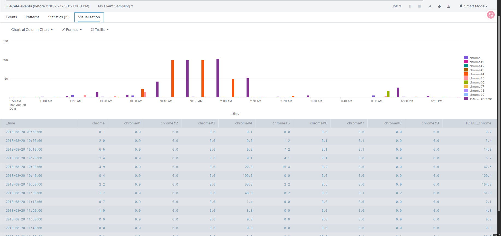

| Horário | `chrome#4` | Total do Chrome |
| --- | --- | --- |
| 10:20 | 0,1% | 6,7% |
| 10:30 | 22,0% | 42,5% |
| **10:40** | **100,0%** | 100,4% |
| **10:50** | **99,3%** | 104,2% |
| 11:00 | 48,8% | 51,3% |
| 11:10 | 1,4% | 2,1% |

**Achado:** o padrão "zero, travado em 100%, zero" não é uso normal. **Praticamente todo o consumo vem de um único processo** (`chrome#4`), ou seja, **uma aba**, e portanto **um site**. Janela do incidente: **~10:20 a ~11:10**.

Tabela completa: [prints/05-chrome-todos-tabela.png](prints/05-chrome-todos-tabela.png) · Primeira versão: [prints/04-chrome-cpu-linha-do-tempo.png](prints/04-chrome-cpu-linha-do-tempo.png)

### Passo 5: quais domínios o BSTOLL-L consultou na janela do pico?

**Por quê:** navegador só executa o que um site entrega. Antes de abrir qualquer site, o computador consulta o DNS. A investigação **sai do endpoint e vai para a rede**.

```spl
index=botsv3 host=BSTOLL-L sourcetype=stream:dns
    earliest="08/20/2018:10:15:00" latest="08/20/2018:10:45:00"
| stats count by query
| sort - count
| head 30
```

> **Leitura:** mostre os domínios que o BSTOLL-L consultou entre 10:15 e 10:45, do mais consultado para o menos.

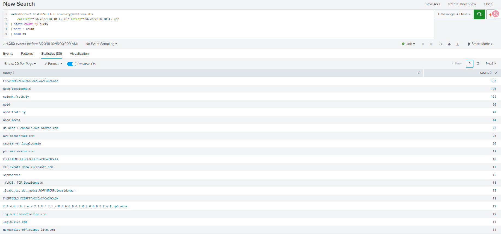

**Achado:** o topo da lista é ruído. **Falsos positivos descartados:**

| Parece | Na verdade é |
| --- | --- |
| `FHFAEBEECACACA...AAA` | **NetBIOS** codificado = `WPAD` |
| `FDEFFAENFDEFFCFGEFFC...AAA` | NetBIOS = `SEPMSERVER` |
| `FHEPFCELEHFCEPFFFACA...ABN` | NetBIOS = `WORKGROUP` |
| `wpad.*`, `*.localdomain`, `splunk.froth.ly` | Descoberta de proxy e serviços internos |

**Lição de método:** ordenar por *mais consultados* mostra o barulho. O domínio malicioso costuma ter **poucas consultas**.

### Passo 6: o que apareceu pela primeira vez perto do início do pico?

**Por quê:** remover o conhecido para enxergar o desconhecido, e ordenar **cronologicamente** em vez de por volume.

```spl
index=botsv3 host=BSTOLL-L sourcetype=stream:dns
    earliest="08/20/2018:10:20:00" latest="08/20/2018:10:40:00"
| where like(query, "%.%")
| search NOT query="wpad*" NOT query="*localdomain" NOT query="*.froth.ly" NOT query="*.arpa" NOT query="*microsoft*" NOT query="*live.com"
| stats count min(_time) as primeira_vez by query
| sort primeira_vez
| eval primeira_vez=strftime(primeira_vez, "%H:%M:%S")
```

> **Leitura:** pegue o DNS do BSTOLL-L entre 10:20 e 10:40, descarte NetBIOS, rede interna e Microsoft, e liste o restante na ordem em que cada domínio apareceu pela primeira vez.

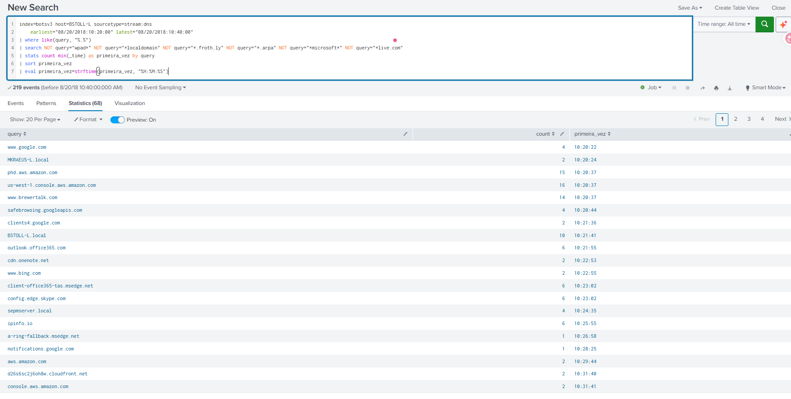

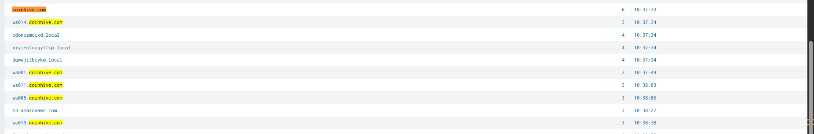

**Achado:**

| Primeira vez | Domínio | Consultas | Leitura |
| --- | --- | --- | --- |
| 10:20:37 | `www.brewertalk.com` | 14 | Fórum de cervejeiros acessado pelo usuário |
| 10:36:30 | `www.mybb.com` | 9 | MyBB, software de fórum |
| **10:37:33** | **`coinhive.com`** | 6 | **Minerador de Monero em JavaScript** |
| 10:37:34 – 10:38:38 | `ws001`, `ws005`, `ws011`, `ws014`, `ws019.coinhive.com` | 3 cada | Servidores **WebSocket** de mineração: minerador ativo |

**Outros falsos positivos e itens observados:**
- `yffrqrjdlrvmvea.local`, `nknhobjv.local`, `cfegsjc.local`: parecem DGA, mas são o **Chrome testando sequestro de DNS** (comportamento padrão do navegador).
- `ipinfo.io` (10:25:55) e `d26s6sc2j6oh8w.cloudfront.net` (10:31:40): observados, **sem ligação comprovada** com o incidente. O CloudFront é provavelmente do console AWS que o usuário usava.

### Passo 7: qual página carregou o Coinhive?

**Por quê:** o DNS mostra que a máquina *procurou* o Coinhive; o HTTP mostra *de qual página* veio o pedido.

```spl
index=botsv3 host=BSTOLL-L sourcetype=stream:http
    earliest="08/20/2018:10:30:00" latest="08/20/2018:10:45:00"
| table _time site uri_path http_referrer status
| sort _time
```

> **Leitura:** liste em ordem de horário as requisições web do BSTOLL-L entre 10:30 e 10:45, com site, caminho, página de origem e código de resposta.

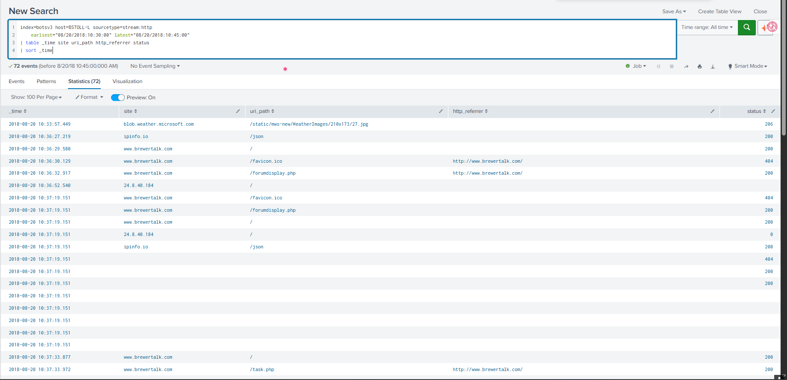

**Achado:** o brewertalk.com usa **HTTP sem criptografia**.

| Horário | Fonte | Evento |
| --- | --- | --- |
| 10:37:33.877 | HTTP | `GET www.brewertalk.com/` |
| **10:37:33** | **DNS** | **`coinhive.com`, no mesmo segundo** |
| 10:37:33.972 | HTTP | `/task.php` (arquivo padrão do MyBB), referer `http://www.brewertalk.com/` |

O navegador consulta o Coinhive **menos de 1 segundo** depois de carregar a página do fórum. É **evidência forte** de que o brewertalk.com servia o script. A conexão ao Coinhive em si é HTTPS e não aparece no HTTP.

Observado: acesso direto ao IP `24.8.40.184` (10:36:52), sem ligação comprovada.

### Passo 8: escopo. O Coinhive aparece em outras máquinas?

**Por quê:** investigar a partir do sintoma acha **uma** vítima; buscar o indicador em todo o ambiente acha **todas**.

```spl
index=botsv3 earliest=0 coinhive
| stats count min(_time) as primeira max(_time) as ultima by sourcetype host
| convert ctime(primeira) ctime(ultima)
| sort primeira
```

> **Leitura:** procure "coinhive" em qualquer log, de qualquer fonte, e mostre onde, em qual máquina, quantas vezes e quando.

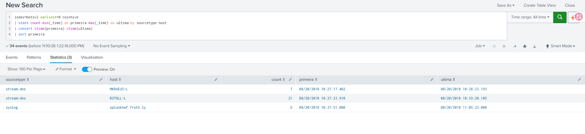

**Achado:**

| Fonte | Máquina | Eventos | Primeira | Última |
| --- | --- | --- | --- | --- |
| `stream:dns` | **MKRAEUS-L** | 7 | **10:27:17** | 10:28:23 |
| `stream:dns` | BSTOLL-L | 21 | 10:37:33 | 10:39:20 |
| `syslog` | splunkhwf.froth.ly | 6 | 10:37:51 | **11:05:23** |

- **Segunda vítima, MKRAEUS-L**, atingida **10 minutos antes** do BSTOLL-L. Não foi detectada no início porque não tem Perfmon.
- O **syslog de rede** registra o Coinhive até **11:05**, e a CPU do BSTOLL-L volta ao normal às **11:10**.

### Passo 9: o antivírus detectou?

**Por quê:** uma terceira fonte, e uma ferramenta de segurança, confirmando. Antivírus usa o **nome da ameaça**, não o domínio.

```spl
index=botsv3 earliest=0 sourcetype=symantec:* (coin* OR *miner* OR jscoin*)
| table _time host sourcetype _raw
| sort _time
```

> **Leitura:** procure nos logs do Symantec qualquer menção a moeda ou minerador e mostre o log completo, em ordem de horário.

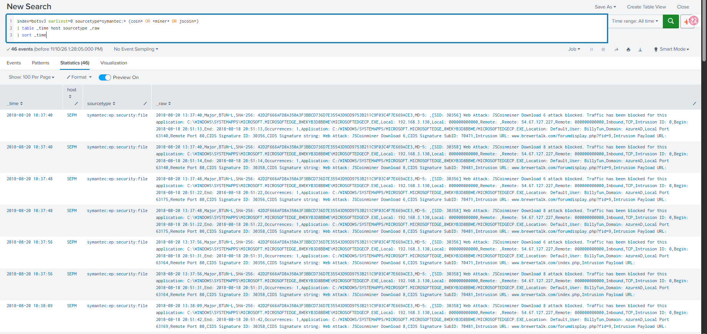

**Achado:**

| Campo | Valor |
| --- | --- |
| Máquina / usuário | **BTUN-L** / BillyTun (192.168.3.130) |
| Assinatura | **Web Attack: JSCoinminer Download** (SID 30356 e 30358) |
| Ação | **attack blocked**: tráfego bloqueado |
| Aplicativo | `MicrosoftEdgeCP.exe` |
| URL | **`www.brewertalk.com/forumdisplay.php?fid=9`** e `/index.php` |
| Servidor remoto | `54.67.127.227:80` |

O antivírus **nomeia o brewertalk.com como origem**. A hipótese do Passo 7 passa a ser **confirmada**.

### Passo 10: quais máquinas o antivírus protegeu?

**Por quê:** comparar a lista do antivírus com a do DNS mostra quem foi protegido e quem ficou exposto. O log não tem os campos separados, então a extração é feita com `rex`.

```spl
index=botsv3 earliest=0 sourcetype=symantec:* (coin* OR *miner* OR jscoin*)
| rex ",(?:Major|Critical|Minor|Info)[^,]*,(?<computador>[^,]+),"
| rex "User: (?<usuario>[^,]+),"
| rex "\[SID: \d+\] (?<assinatura>[^.]+)\."
| stats count min(_time) as primeira max(_time) as ultima values(assinatura) as assinaturas values(usuario) as usuarios by computador
| convert ctime(primeira) ctime(ultima)
| sort primeira
```

> **Leitura:** recorte de cada log de detecção a máquina, o usuário e o nome do ataque, e resuma por máquina.

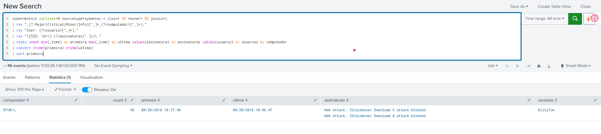

**Achado:** **apenas o BTUN-L** teve detecções: **46 bloqueios** entre 10:37:40 e 10:46:47. O BTUN-L também **não aparece no DNS do Coinhive**: o antivírus bloqueou o script ao baixar a página, antes de o navegador contatar o minerador. **BSTOLL-L e MKRAEUS-L não têm nenhuma detecção.**

## Conclusão

**O que aconteceu:** o fórum externo `www.brewertalk.com` (MyBB, HTTP sem criptografia) entregava aos visitantes o script do **Coinhive**, que usa a CPU do visitante para minerar Monero sem consentimento (*cryptojacking*). Não foi necessária nenhuma ação do usuário além de visitar a página.

**Impacto:** o BSTOLL-L teve a CPU consumida em ~100% por cerca de 30 minutos. Não há evidência de persistência, roubo de dados ou execução fora do navegador: o consumo cessou com o fim do tráfego para o Coinhive.

**Lacuna de proteção:** o Symantec bloqueou a ameaça no BTUN-L (Edge), mas não registrou nada no BSTOLL-L (Chrome) nem no MKRAEUS-L. Os logs analisados não permitem afirmar a causa. Hipóteses: agente ausente ou desatualizado nessas máquinas, ou proteção web sem cobertura para o Chrome.

## Recomendações (N1 → N2)

1. **Bloquear** `brewertalk.com`, `coinhive.com` e `*.coinhive.com` no proxy/DNS corporativo.
2. **Verificar o agente Symantec** no BSTOLL-L e no MKRAEUS-L (instalado, atualizado, política de IPS/proteção web aplicada ao Chrome).
3. **Ampliar a telemetria:** só o BSTOLL-L tem Perfmon e o SEPM não tem Sysmon. Sem isso, a mineração no MKRAEUS-L não pôde ser confirmada.
4. **Criar alerta** para consultas DNS a domínios de mineração conhecidos (ex.: `*coinhive*`, `*coin-hive*`, `*cryptoloot*`).
5. **Orientar os usuários** envolvidos sobre o incidente.

## Queries

Todas as queries comentadas: [queries.spl](queries.spl)
