<div align="center">

# `caso 02` · Phishing com macro e contas comprometidas


**O FBI avisou que a Frothly tinha sido invadida. Fui atrás do e-mail de phishing que abriu a porta,**<br>
**e descobri que a porta já estava aberta: o atacante mandou o phishing de dentro de uma conta da própria empresa.**

</div>

---

```console
analista@soc:~$ cat chamado.txt
> ORIGEM ........ FBI notificou a CEO, Grace Hoppy, de uma invasão do grupo Taedonggang (APT)
> PISTA ......... o grupo é conhecido por spearphishing com anexo malicioso
> PEDIDO ........ verificar se recebemos esse e-mail, para quem foi e se alguém abriu
> PAPEL ......... Analista de SOC N1 de plantão
```

```console
analista@soc:~$ cat incidente.txt
> DATA .......... 20/08/2018
> VETOR ......... e-mail "Draft Financial Plan for Brewery FY2019" com Excel com macro (.xlsm)
> MALWARE ....... W97M.Empstage (macro do Office), barrado pelo Office 365 e pelo antivírus
> ATACANTE ...... IP 104.207.83.63, Hong Kong
> CONTAS ........ bgist@froth.ly (Bruce Gist) · fyodor@froth.ly (Fyodor Malteskesko)
> FONTES ........ stream:smtp · ms:o365:reporting:messagetrace · Sysmon · WinEventLog · ms:aad:signin
> IMPACTO ....... malware não executado; 2 contas usadas pelo atacante com login válido e sem MFA
```

> [!NOTE]
> Os horários estão como aparecem no meu Splunk, em **GMT-03:00 (Brasília)**. Os logs que trazem hora em UTC (ex.: `endtime` do Stream, `signinDateTime` do Azure AD) ficam 3 horas à frente. Para correlacionar, uso sempre o `_time`.
>
> As buscas foram feitas com o seletor de tempo em **All time**, porque os dados são de 2018.

## `$ cat veredito.txt`

| Pessoa | Conta | Papel no caso | Resultado |
| :-- | :-- | :-- | :-- |
| **Bruce Gist** | bgist@froth.ly | "Remetente" do phishing; 14 logins vindos de Hong Kong | 🔴 **Conta usada pelo atacante** |
| **Fyodor Malteskesko** | fyodor@froth.ly | Destinatário do phishing; 13 logins vindos de Hong Kong | 🔴 **Conta usada pelo atacante** |
| Grace Hoppy (CEO) | ghoppy@froth.ly | Destinatária | 🟢 Recebeu só a cópia sem o anexo |
| Bud Stoll | bstoll@froth.ly | Destinatário | 🟢 Recebeu só a cópia sem o anexo |
| Al Bungstein | abungstein@froth.ly | Destinatário | 🟢 Recebeu só a cópia sem o anexo |

## `$ ./correlacionar --fontes`

Cinco fontes, e o mesmo IP amarrando a história:

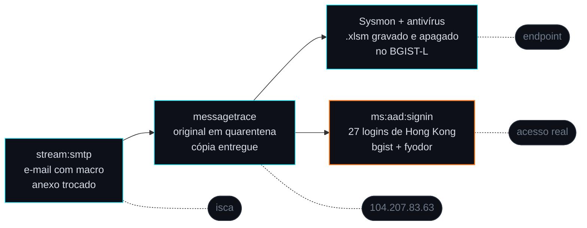

## `$ cat linha-do-tempo.log`

| Horário | Host / origem | Fonte | Evento |
| :-- | :-- | :-- | :-- |
| 06:55:12 | Office 365 | messagetrace | 🟢 E-mail **original** (com o `.xlsm`) vai para **quarentena** nos 4 destinatários |
| 06:55:13 | Office 365 | messagetrace | Cópia **sem o anexo** é entregue aos 4 destinatários e a `ubuntu@ec2-52-38-112-145...` |
| **06:55:14** | rede (`matar`) | stream:smtp | 🟠 **"Draft Financial Plan for Brewery FY2019"** passa pela rede, enviado como `bgist@froth.ly` a partir de `104.207.83.63`. O anexo já aparece trocado por `Malware Alert Text.txt` |
| 06:55:52 | BGIST-L | Sysmon (ID 11) | O app de e-mail do Windows (`HxTsr.exe`) grava `...FY2019-Draft[66].xlsm` no disco do Bruce |
| 06:56:39 | BGIST-L | WinEventLog (antivírus) | 🟢 **`W97M.Empstage`** detectado e o arquivo é **apagado** (*Cleaned by Deletion*) |
| **07:47 – 08:10** | Hong Kong | ms:aad:signin | 🔴 **Logins com sucesso, sem MFA**, nas contas `bgist` (14) e `fyodor` (13) a partir de `104.207.83.63` |
| 07:47 – 08:10 | Hong Kong | ms:o365:management | Ações dentro do Office 365 a partir do mesmo IP (investigado no [caso 03](../03-office365-persistencia/)) |
| 12:15 | externo | stream:smtp | `hyunki1984@naver.com` manda à CEO o e-mail *"All your datas belong to us"* |
| 12:19 | Grace Hoppy | stream:smtp | A CEO encaminha esse e-mail para Bud Stoll, Billy Tun e Jeremiah Wortoski |

<sub>Intervalo 07:47 – 08:10 conforme a primeira página de resultados do passo 08.</sub>

## `$ ./investigar --passo-a-passo`

Cada passo traz o **porquê**, a **query**, a **leitura em português**, a **evidência** e o **achado**. Deixei também os dois momentos em que a busca voltou vazia, porque foram os que mais me ensinaram.

<details open>
<summary><b>00 · Mapa das fontes</b> <code>o que existe para olhar?</code></summary>
<br>

**Por quê:** antes de qualquer hipótese, saber que tipos de log o ambiente tem. Sem isso, uma busca vazia não diz nada.

```spl
| tstats count where index=botsv3 by sourcetype
| sort -count
```

> **Leitura:** conte os eventos do BOTS v3 separados por tipo de log, do maior para o menor. O `tstats` só olha os metadados indexados, por isso é rápido.

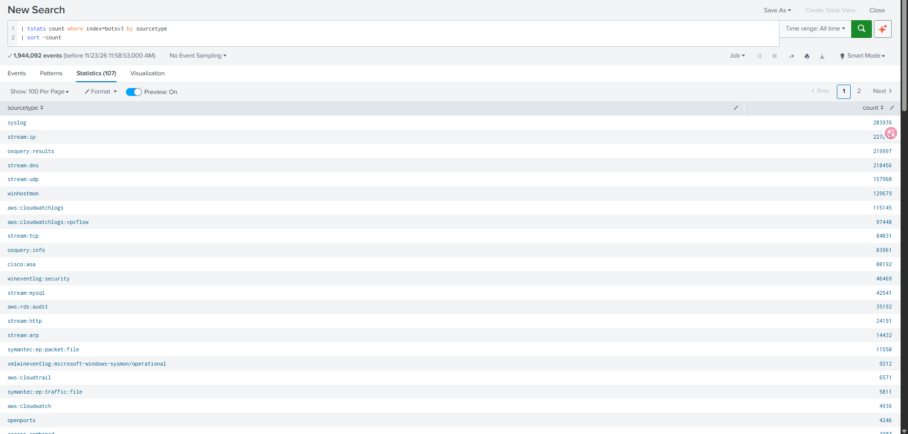

**Achado:** volume não é importância. O `syslog` lidera com 283 mil eventos, enquanto fontes decisivas como `aws:cloudtrail` têm poucos milhares.

</details>

<details>
<summary><b>01 · Onde estão os e-mails</b> <code>qual fonte responde o chamado?</code></summary>
<br>

**Por quê:** o chamado fala de e-mail com anexo. Primeiro, descobrir onde o e-mail fica registrado.

```spl
| tstats count where index=botsv3 by sourcetype
| search sourcetype=*smtp* OR sourcetype=*o365* OR sourcetype=*mail*
```

> **Leitura:** da lista de tipos de log, mostre só os que têm "smtp", "o365" ou "mail" no nome.

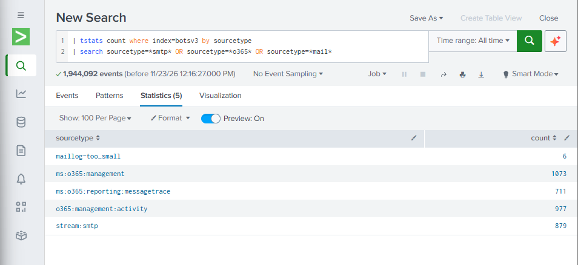

**Achado:** 5 fontes. `maillog-too_small` (6 eventos) é ruído. O `stream:smtp` captura o e-mail na rede **com dados dos anexos**, então foi o ponto de partida. As fontes do Office 365 ficaram para a correlação.

</details>

<details>
<summary><b>02 · Como é um e-mail nesse log</b> <code>conhecer o campo antes de filtrar</code></summary>
<br>

**Por quê:** cada fonte dá um nome diferente para remetente, destinatário e anexo. Abri um e-mail inteiro antes de filtrar qualquer coisa.

```spl
index=botsv3 sourcetype=stream:smtp
```

> **Leitura:** me mostre os e-mails capturados na rede.

Campos que importam numa investigação de e-mail (trecho de um evento):

```text
sender: Grace Hoppy <ghoppy@froth.ly>      ← quem mandou
receiver: [ ... ]                           ← para quem (lista)
subject: Fw: All your datas belong to us    ← a isca
attach_filename: [ ... ]                    ← nome do anexo (lista)
attach_type: [ ... ]                        ← tipo do anexo
src_ip: 104.47.38.43                        ← de onde veio na rede
```

**Achado:** o `[ ... ]` indica que o campo é uma **lista**. Isso importou no passo seguinte. Também anotei como pista o assunto *"All your datas belong to us"*, encaminhado pela CEO.

</details>

<details>
<summary><b>03 · Quais e-mails têm anexo</b> <code>a visão de caixa de entrada</code></summary>
<br>

**Por quê:** reduzir 879 e-mails aos que têm anexo e olhar só quem, para quem, quando, assunto e anexo.

Primeira tentativa:

```spl
index=botsv3 sourcetype=stream:smtp attach_filename=*
| table _time sender receiver subject attach_filename
```

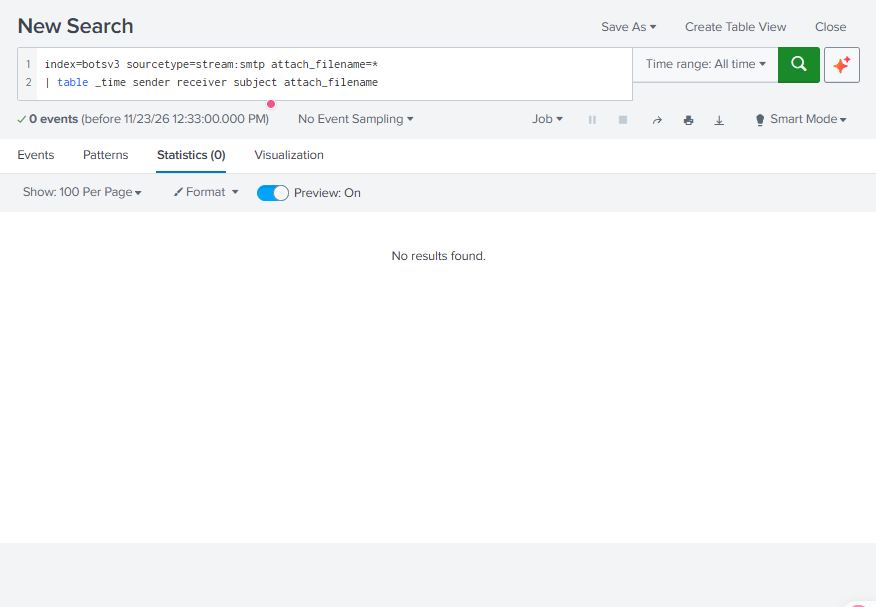

Voltou **0 eventos**. Quando o campo é uma lista, o Splunk acrescenta `{}` ao nome: o campo certo é `attach_filename{}`. **Zero resultados não quer dizer que não tem nada. Pode ser o nome do campo.**

```spl
index=botsv3 sourcetype=stream:smtp attach_filename{}=*
| table _time sender receiver{} subject attach_filename{}
```

> **Leitura:** me mostre em tabela os e-mails que têm anexo: hora, remetente, destinatários, assunto e nome do anexo.

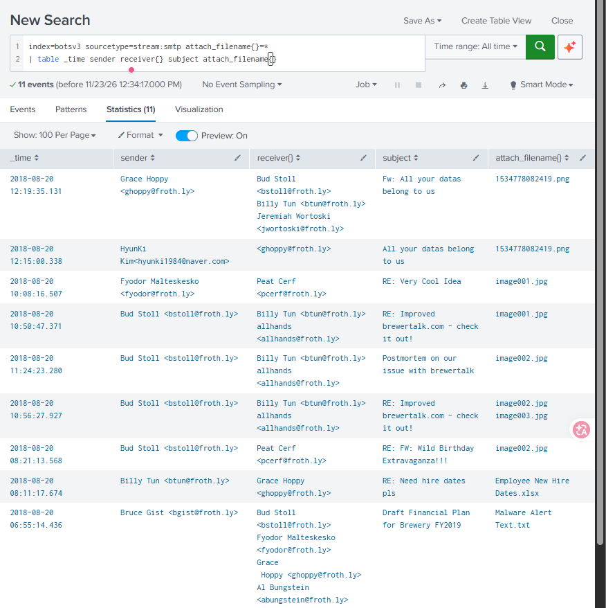

**Achado:** 11 e-mails. Os `image00X.jpg` são imagens automáticas de respostas no Outlook (ruído). Duas linhas destoam:

| Hora | Remetente | Assunto | Anexo | Por que destoa |
| :-- | :-- | :-- | :-- | :-- |
| 06:55 | Bruce Gist (interno) | Draft Financial Plan for Brewery FY2019 | `Malware Alert Text.txt` | Assunto e anexo não combinam; vai para 4 cargos-chave; é o primeiro do dia |
| 12:15 | HyunKi Kim (`naver.com`) | All your datas belong to us | `1534778082419.png` | Único remetente externo; tom de ameaça; só para a CEO |

Como o chamado pergunta **por onde** o atacante entrou, segui o das 06:55: veio antes e tem cara de isca.

</details>

<details>
<summary><b>04 · Abrir o e-mail das 06:55</b> <code>o .txt não é a arma</code></summary>
<br>

**Por quê:** um `.txt` sozinho quase nunca executa nada. Precisava entender por que um "plano financeiro" chegou com um "alerta de malware".

```spl
index=botsv3 sourcetype=stream:smtp subject="Draft Financial Plan for Brewery FY2019"
```

> **Leitura:** abra o e-mail com exatamente esse assunto. As aspas são necessárias por causa dos espaços.

Corpo do e-mail (`content_body`):

```text
Here is a financial model we can use for FY2019 planning. For the worksheet
to operate properly, you will need to enable macros.
Thanks, Bruce
```

O anexo `Malware Alert Text.txt` vinha em base64. Decodificado (fiz no [CyberChef](https://gchq.github.io/CyberChef/), receita *From Base64*):

```text
Malware was detected in one or more attachments included with this email message.
Action: All attachments have been removed.
Frothly-Brewery-Financial-Planning-FY2019-Draft.xlsm    W97M.Empstage
```

Cabeçalhos relevantes (`content`):

```text
x-originating-ip: [104.207.83.63]                       ← IP de origem real
authentication-results: spf=none                        ← remetente não autenticado
x-forefront-antispam-report: SFV:SPM; ... SCL:5         ← classificado como spam
x-ms-exchange-generated-message-source: DC Pre Content Filter Agent
```

**Achado:** o `.txt` é o **aviso do filtro do Office 365**, que tirou o anexo original e deixou o recado no lugar. A arma era **`Frothly-Brewery-Financial-Planning-FY2019-Draft.xlsm`**, um Excel **com macro** (`.xlsm`), detectado como **`W97M.Empstage`** (família de malware de macro do Office). O texto do e-mail pede para *habilitar macros*: o golpe clássico. Novo IOC: **`104.207.83.63`**.

</details>

<details>
<summary><b>05 · O arquivo apareceu em outro lugar?</b> <code>afrouxar a busca antes de concluir</code></summary>
<br>

**Por quê:** o filtro barrou esse e-mail, mas o arquivo pode ter chegado por outro caminho. É a pergunta de escopo.

Primeira tentativa, com o nome exato:

```spl
index=botsv3 "Frothly-Brewery-Financial-Planning-FY2019-Draft.xlsm"
```

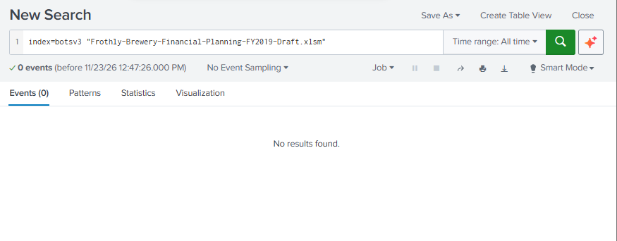

De novo **0 eventos**. Em vez de concluir "não chegou a lugar nenhum", afrouxei a busca para um pedaço do nome:

```spl
index=botsv3 FY2019
```

> **Leitura:** qualquer evento, de qualquer fonte, que tenha a palavra FY2019.

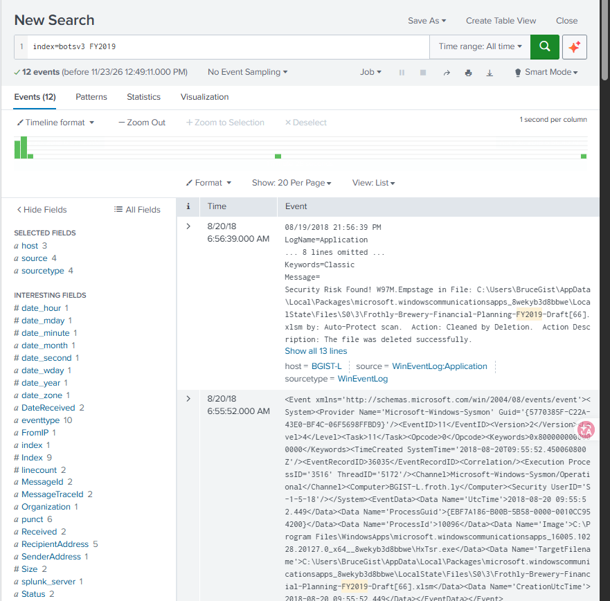

**Achado:** 12 eventos. O nome real no disco era **`...FY2019-Draft[66].xlsm`**: o Windows acrescentou `[66]` ao salvar a cópia, e por isso a busca exata falhou. Na máquina **BGIST-L**:

- **Sysmon, EventID 11 (arquivo criado):** `HxTsr.exe`, o app de e-mail do Windows, gravou o `.xlsm` na pasta do usuário BruceGist.
- **Antivírus:** *"Security Risk Found! W97M.Empstage ... Action: Cleaned by Deletion"*, 47 segundos depois.

</details>

<details>
<summary><b>06 · Em quais máquinas e em que ordem</b> <code>host é quem registra, não quem foi afetado</code></summary>
<br>

**Por quê:** a coluna da esquerda mostrava 3 hosts. Precisava saber se eram 3 máquinas afetadas.

```spl
index=botsv3 FY2019
| table _time host sourcetype
```

> **Leitura:** liste os 12 eventos com hora, host e tipo de log.

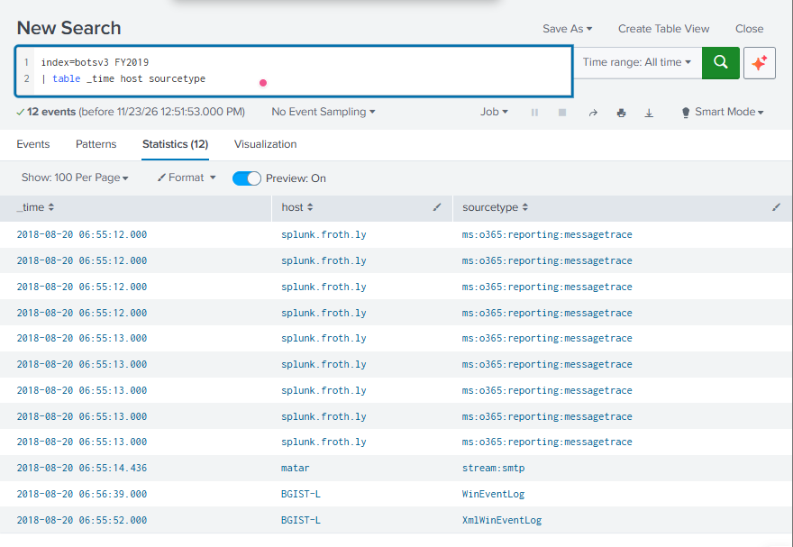

**Achado:** só uma máquina de usuário. `splunk.froth.ly` é o próprio servidor Splunk (que busca os logs do Office 365 na nuvem) e `matar` é o sensor de rede do Stream. A única máquina tocada foi a **BGIST-L**, do próprio "remetente".

</details>

<details>
<summary><b>07 · O rastreio oficial do e-mail</b> <code>entregue ou barrado?</code></summary>
<br>

**Por quê:** o messagetrace do Office 365 registra, para cada destinatário, o que aconteceu com a mensagem. É onde se responde "chegou?".

```spl
index=botsv3 sourcetype=ms:o365:reporting:messagetrace FY2019
| table _time SenderAddress RecipientAddress Subject Status FromIP
```

> **Leitura:** mostre o rastreio do e-mail do plano financeiro: remetente, destinatário, status e IP de origem.

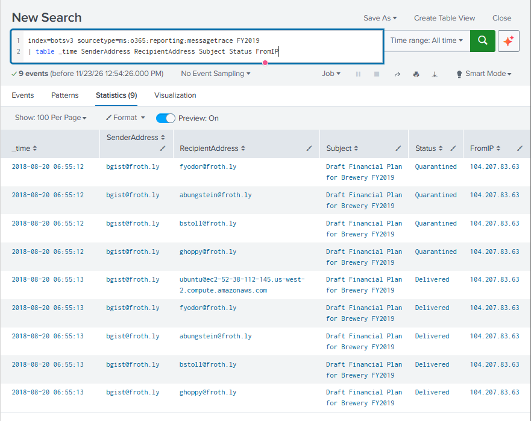

**Achado:**

- **06:55:12:** o original foi para **quarentena** nos 4 destinatários.
- **06:55:13:** uma versão foi **entregue**: a cópia sem o anexo, com o `.txt` de aviso (passo 04).
- **`FromIP = 104.207.83.63`** em todas as linhas, o mesmo IP do cabeçalho. **Duas fontes confirmando o mesmo IOC.**
- `ubuntu@ec2-52-38-112-145...amazonaws.com` também recebeu. O e-mail na rede ia para `172.31.38.181`, faixa interna da AWS, então a hipótese mais provável é o servidor que recebe/copia os e-mails da Frothly. **Deixei como "a verificar".**

</details>

<details>
<summary><b>08 · Pivô no IP</b> <code>o que mais esse IP fez?</code></summary>
<br>

**Por quê:** o e-mail saiu da conta interna `bgist@froth.ly`, mas de um IP externo e sem SPF. Ou o Bruce mandou malware para a diretoria, ou alguém está usando a conta dele.

```spl
index=botsv3 104.207.83.63
| table _time host sourcetype
```

> **Leitura:** qualquer evento com esse IP, em qualquer fonte: quando, onde e em qual log.

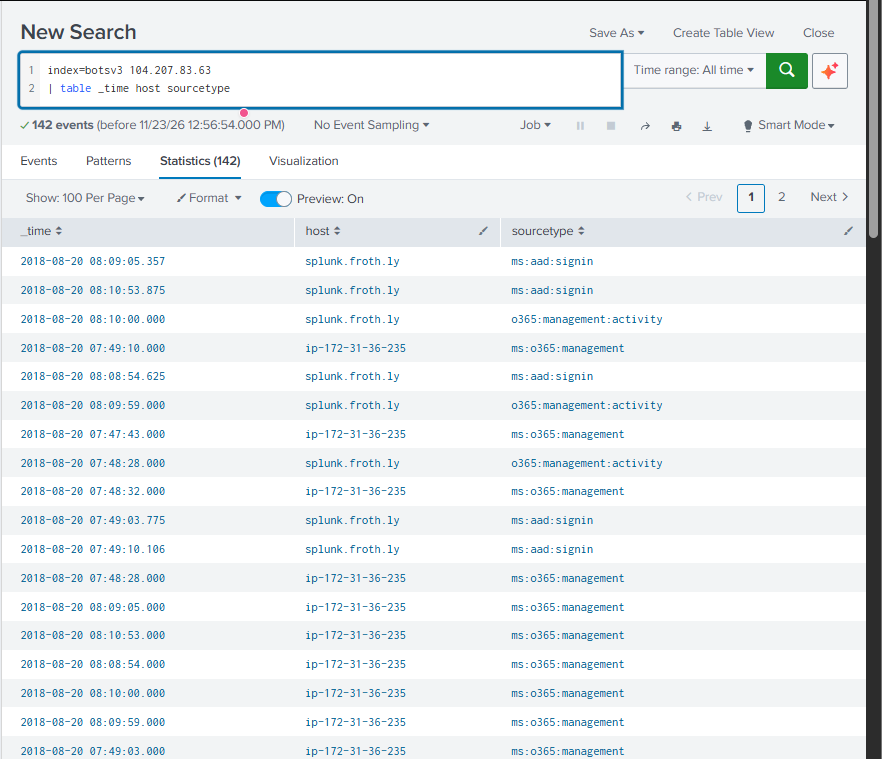

**Achado:** **142 eventos**, não só o e-mail. Aparecem `ms:aad:signin` (**logins** em contas Microsoft) e `ms:o365:management` / `o365:management:activity` (**ações** dentro do Office 365), entre 07:47 e 08:10.

</details>

<details>
<summary><b>09 · Quem fez login e de onde</b> <code>a virada do caso</code></summary>
<br>

**Por quê:** saber quais contas esse IP usou.

```spl
index=botsv3 sourcetype=ms:aad:signin 104.207.83.63
```

> **Leitura:** mostre os logins vindos desse IP. Depois, cliquei nos campos `userPrincipalName` e `location.city` na barra lateral para ver os valores.

Trecho de um evento:

```text
userPrincipalName: fyodor@froth.ly
appDisplayName: Office 365 Exchange Online
ipAddress: 104.207.83.63
loginStatus: Success
mfaRequired: false
deviceInformation: ;Windows 7;IE 10.0;
```

<div align="center">

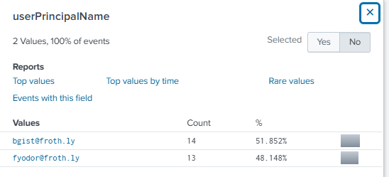
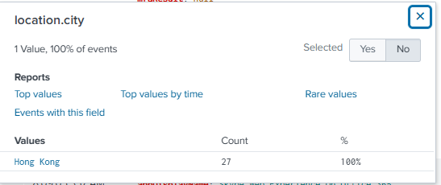

<sub>27 logins: 14 na conta do Bruce e 13 na do Fyodor, todos de Hong Kong.</sub>

</div>

**Achado:** o IP fez **27 logins com sucesso**, sem MFA, em **duas contas diferentes**: `bgist` (14) e `fyodor` (13). **100% de Hong Kong** (`country: HK`), com um Windows 7 / IE 10. Não é comportamento de funcionário: é **alguém de fora usando senhas válidas** da Frothly.

</details>

## `$ cat conclusao.md`

**O que aconteceu:** às 06:55, um e-mail de "plano financeiro" saiu da conta do **Bruce Gist** para 4 pessoas, incluindo a CEO, com um Excel com macro (`W97M.Empstage`). O Office 365 colocou o original em quarentena e entregou só uma cópia sem o anexo. Na máquina do Bruce, o antivírus apagou o arquivo salvo. **O malware não foi executado em nenhuma máquina** pelo que os logs mostram.

**A virada:** o e-mail não veio do Bruce. Veio do IP `104.207.83.63`, em **Hong Kong**, que também fez **27 logins com sucesso e sem MFA** nas contas do **Bruce** e do **Fyodor**. O phishing não foi a porta de entrada: **o atacante já tinha as senhas** e usou uma conta interna para tentar ampliar o acesso.

**O que os logs não mostram:** como o atacante obteve as senhas. Nesse dataset não há evidência do comprometimento inicial das duas contas. Fica para o N2.

| Técnica | Nome | Como apareceu |
| :-- | :-- | :-- |
| [T1566.001](https://attack.mitre.org/techniques/T1566/001/) | Phishing: Spearphishing Attachment | Excel com macro enviado a cargos-chave, pedindo para habilitar macros |
| [T1078.004](https://attack.mitre.org/techniques/T1078/004/) | Valid Accounts: Cloud Accounts | Logins válidos no Office 365 a partir de Hong Kong em duas contas da empresa |

**IOCs:**

| Tipo | Valor |
| :-- | :-- |
| IP | `104.207.83.63` (Hong Kong) |
| Arquivo | `Frothly-Brewery-Financial-Planning-FY2019-Draft.xlsm` |
| Detecção | `W97M.Empstage` |
| Assunto | `Draft Financial Plan for Brewery FY2019` |
| E-mail externo (pista para o caso 03) | `hyunki1984@naver.com` |

## `$ ./escalar --para N2`

- [ ] **Redefinir as senhas** de `bgist@froth.ly` e `fyodor@froth.ly` e **encerrar as sessões ativas**
- [ ] **Exigir MFA** em todas as contas do Office 365: nesses logins, `mfaRequired: false`
- [ ] **Bloquear** `104.207.83.63` e alertar para logins de países fora do padrão da empresa
- [ ] **Investigar o que foi feito** nas duas contas entre 07:47 e 08:10 (`ms:o365:management`): é o [caso 03](../03-office365-persistencia/)
- [ ] **Descobrir como as senhas vazaram** (reuso de senha, phishing anterior, outro vetor)
- [ ] **Avisar os 4 destinatários** para não pedirem a liberação do e-mail em quarentena
- [ ] **Confirmar o papel** do destinatário `ubuntu@ec2-52-38-112-145.us-west-2.compute.amazonaws.com`

---

<div align="center">

[← voltar para os casos](../README.md) · [queries deste caso](queries.spl)

</div>
