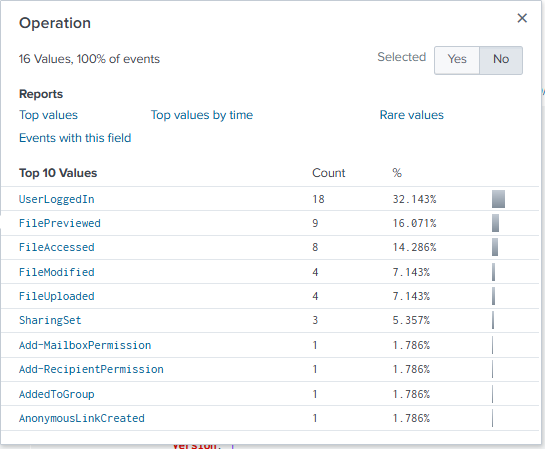
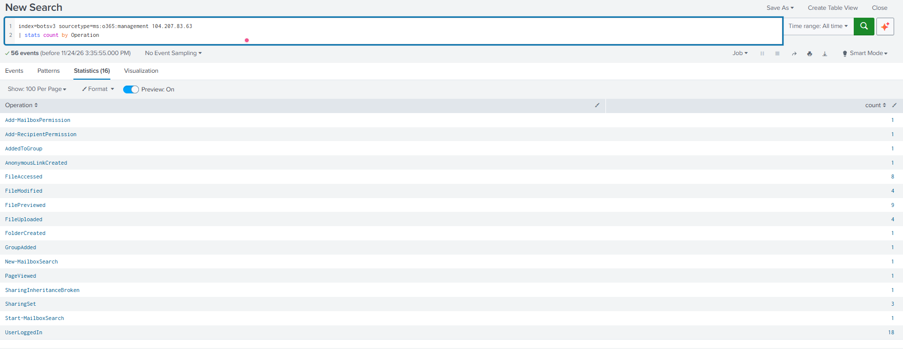
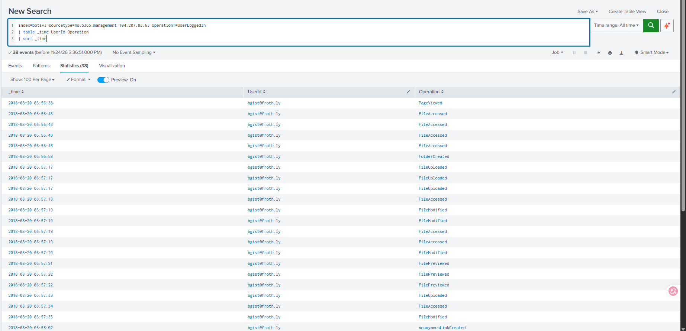
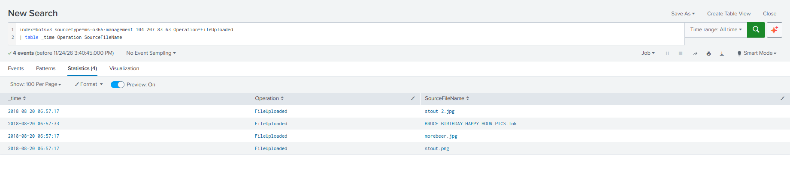
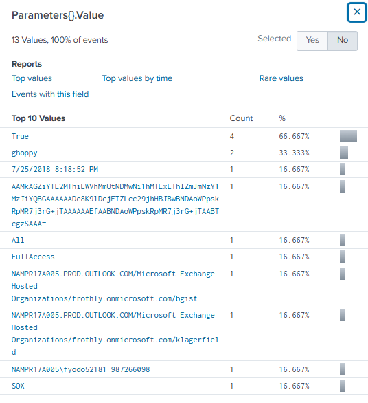
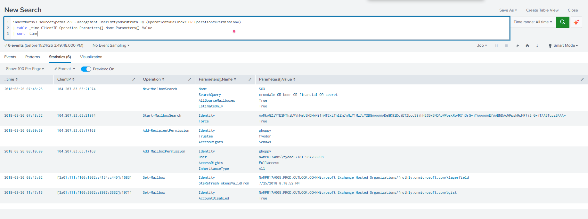
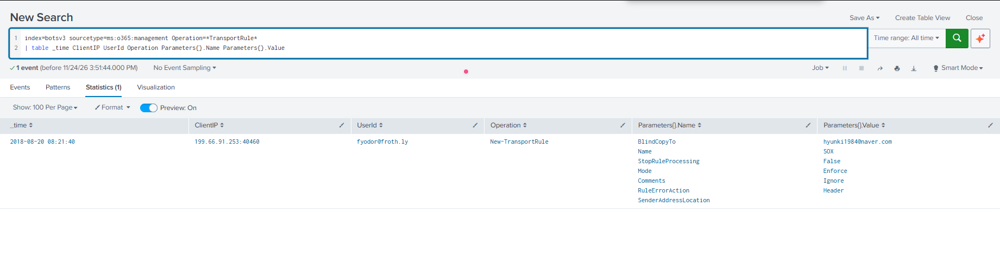

<div align="center">

# `caso 03` · O que o atacante fez dentro do Office 365


**Eu sabia que o atacante tinha a senha de duas contas. Faltava saber o que ele fez com elas.**<br>
**A resposta: uma isca no OneDrive, uma busca em todos os e-mails e uma regra que continuava vazando tudo mesmo depois da troca de senha.**

</div>

---

```console
analista@soc:~$ cat chamado.txt
> ORIGEM ........ caso 02: atacante de Hong Kong com login válido nas contas bgist e fyodor
> PEDIDO ........ descobrir o que ele fez no Office 365 antes de trocarmos as senhas
> PERGUNTA ...... ele deixou algum jeito de continuar recebendo informação?
> PAPEL ......... Analista de SOC N1 de plantão
```

```console
analista@soc:~$ cat incidente.txt
> DATA .......... 20/08/2018
> ISCA .......... BRUCE BIRTHDAY HAPPY HOUR PICS.lnk no OneDrive, com link público
> COLETA ........ busca em todas as caixas de e-mail: "cromdale OR beer OR financial OR secret"
> PERSISTÊNCIA .. regra de transporte "SOX" com cópia oculta para hyunki1984@naver.com
> PRIVILÉGIO .... SendAs e FullAccess na caixa da CEO para a conta fyodor
> IPs ........... 104.207.83.63 · 199.66.91.253
> FONTE ......... ms:o365:management (auditoria do Office 365)
```

> [!NOTE]
> Horários em **GMT-03:00 (Brasília)**, como aparecem no meu Splunk, com o seletor de tempo em **All time**. Este caso continua direto do [caso 02](../02-phishing-contas-comprometidas/).

## `$ cat veredito.txt`

| Fase | Conta | IP | O que fez | Gravidade |
| :-- | :-- | :-- | :-- | :-: |
| **1 · Isca** | bgist | 104.207.83.63 | Subiu um `.lnk` disfarçado entre fotos no OneDrive e criou um link público | 🔴 |
| **2 · Coleta** | fyodor | 104.207.83.63 | Buscou palavras-chave em **todas** as caixas de e-mail | 🔴 |
| **3 · Persistência** | fyodor | **199.66.91.253** | Regra de transporte copiando e-mails para fora | 🔴🔴 |
| **4 · Privilégio** | fyodor | 104.207.83.63 | Ganhou SendAs e FullAccess na caixa da CEO | 🔴 |

## `$ cat linha-do-tempo.log`

| Horário | Conta | IP | Evento |
| :-- | :-- | :-- | :-- |
| 06:55:14 | bgist | 104.207.83.63 | *(caso 02)* phishing com `.xlsm` barrado |
| 06:56:38 – 06:56:43 | bgist | 104.207.83.63 | Reconhecimento: `PageViewed`, `FileAccessed` |
| 06:56:58 | bgist | 104.207.83.63 | `FolderCreated` |
| 06:57:17 | bgist | 104.207.83.63 | Sobe `stout-2.jpg`, `morebeer.jpg`, `stout.png` (disfarce) |
| **06:57:33** | bgist | 104.207.83.63 | 🟠 **Sobe `BRUCE BIRTHDAY HAPPY HOUR PICS.lnk`** |
| **06:58:02** | bgist | 104.207.83.63 | 🟠 **`AnonymousLinkCreated`**: link público para a pasta |
| 06:59:18 – 07:01:38 | — | — | O `.lnk` aparece em 8 laptops ([caso 04](../04-endpoint-empire/)) |
| **07:48:28** | fyodor | 104.207.83.63 | 🔴 **`New-MailboxSearch`** em todas as caixas |
| 07:48:32 | fyodor | 104.207.83.63 | `Start-MailboxSearch` |
| 08:09:59 | fyodor | 104.207.83.63 | 🔴 `Add-RecipientPermission`: **SendAs** na caixa da CEO |
| 08:10:00 | fyodor | 104.207.83.63 | 🔴 `Add-MailboxPermission`: **FullAccess** na caixa da CEO |
| **08:21:40** | fyodor | **199.66.91.253** | 🔴🔴 **`New-TransportRule` "SOX"**: cópia oculta para `hyunki1984@naver.com` |
| 11:47:15 | — | Microsoft | 🟢 Conta `bgist` **desativada** (provável resposta da Frothly) |
| 12:15 | — | externo | *(caso 02)* `hyunki1984@naver.com` manda à CEO *"All your datas belong to us"* |

## `$ ./investigar --passo-a-passo`

<details open>
<summary><b>01 · Que ações o atacante fez</b> <code>partir do que já sei: o IP</code></summary>
<br>

**Por quê:** o caso 02 terminou com o IP `104.207.83.63`. O primeiro passo é ver o que ele fez na auditoria do Office 365.

```spl
index=botsv3 sourcetype=ms:o365:management 104.207.83.63
```

> **Leitura:** mostre as ações registradas no Office 365 vindas do IP do atacante. Depois cliquei no campo `Operation` na barra lateral.



**Achado:** agrupando por comportamento: **entrar** (`UserLoggedIn`), **bisbilhotar** (`FilePreviewed`, `FileAccessed`), **colocar arquivos** (`FileUploaded`, `FileModified`), **compartilhar** (`SharingSet`, `AnonymousLinkCreated`) e **dar permissões** (`Add-MailboxPermission`, `Add-RecipientPermission`). A janela diz **16 valores**, mas mostra só 10.

</details>

<details>
<summary><b>02 · As 16 ações</b> <code>o raro costuma ser o importante</code></summary>
<br>

```spl
index=botsv3 sourcetype=ms:o365:management 104.207.83.63
| stats count by Operation
```

> **Leitura:** conte quantas vezes cada ação aconteceu, todas, não só as 10 mais comuns.



**Achado:** as 6 escondidas incluíam as mais graves: **`New-MailboxSearch`** e **`Start-MailboxSearch`**, uma busca de administrador em várias caixas de e-mail ao mesmo tempo.

</details>

<details>
<summary><b>03 · Em que ordem e com qual conta</b> <code>a timeline conta a história</code></summary>
<br>

```spl
index=botsv3 sourcetype=ms:o365:management 104.207.83.63 Operation!=UserLoggedIn
| table _time UserId Operation
| sort _time
```

> **Leitura:** em ordem de horário, tudo o que o atacante fez, menos os logins, e com qual conta.



Fim da tabela (fase 2):

```text
2018-08-20 07:48:28   fyodor@froth.ly   New-MailboxSearch
2018-08-20 07:48:32   fyodor@froth.ly   Start-MailboxSearch
2018-08-20 08:09:59   fyodor@froth.ly   Add-RecipientPermission
2018-08-20 08:10:00   fyodor@froth.ly   Add-MailboxPermission
```

**Achado:** **duas fases e duas contas.**

- **Fase 1 (bgist, 06:56–06:58):** pasta nova → upload → link público, em menos de 2 minutos. Começa **1 minuto depois** do phishing do caso 02.
- **Fase 2 (fyodor, 07:48–08:10):** busca nos e-mails e permissões. São ações de administrador, o que explica por que o atacante usou a conta do Fyodor.

Às **06:58:02**, seis ações aparecem no mesmo segundo (`AnonymousLinkCreated`, `SharingSet` ×3, `SharingInheritanceBroken`, `AddedToGroup`, `GroupAdded`). Ninguém clica seis vezes em um segundo: criar um link de compartilhamento faz o próprio SharePoint gerar um grupo de compartilhamento e ajustar permissões. Tratei `AddedToGroup`/`GroupAdded` como **efeito colateral do link**, não como o atacante mexendo em grupos.

</details>

<details>
<summary><b>04 · Que arquivos foram enviados</b> <code>a isca</code></summary>
<br>

```spl
index=botsv3 sourcetype=ms:o365:management 104.207.83.63 Operation=FileUploaded
| table _time Operation SourceFileName
```

> **Leitura:** mostre os arquivos que o atacante subiu.



**Achado:** três imagens de cerveja no mesmo segundo (**disfarce**) e, 16 segundos depois, sozinho: **`BRUCE BIRTHDAY HAPPY HOUR PICS.lnk`**. Um `.lnk` é um atalho do Windows, e um atalho pode executar qualquer comando ao ser aberto. Nome curioso, vindo do OneDrive do próprio Bruce, numa pasta de fotos, com link público: a isca perfeita, e que não passa pelo filtro de anexos do e-mail.

</details>

<details>
<summary><b>05 · Onde o atalho apareceu</b> <code>buscar por palavras soltas</code></summary>
<br>

Lição do caso 02: nomes de arquivo mudam entre logs (`[66]`, `%20`). Busquei por duas palavras do nome:

```spl
index=botsv3 BIRTHDAY HAPPY
| table _time host sourcetype
```

> **Leitura:** onde mais aparecem eventos com as palavras BIRTHDAY e HAPPY: quando, em qual máquina e em qual log.

**Achado** (resumo do resultado):

| Máquina | Primeiro evento | Fonte |
| :-- | :-- | :-- |
| JWORTOS-L | 06:59:18 | Sysmon |
| ABUNGST-L | 06:59:24 | Sysmon |
| PCERF-L | 06:59:28 | Sysmon |
| BTUN-L | 06:59:30 | Sysmon |
| BSTOLL-L | 06:59:41 **e de novo às 08:28** | Sysmon + WinEventLog |
| BGIST-L | 07:00:06 | Sysmon + WinEventLog |
| FYODOR-L | 07:01:33 | Sysmon |
| MKRAEUS-L | — | Sysmon (encontrada no caso 04: esta tabela foi cortada em 100 linhas) |
| SEPM (antivírus) | 08:39:51 | symantec:ep |

Vários laptops em três minutos é rápido demais para tantas pessoas clicarem: o mais provável era a **sincronização do OneDrive**. Mas "o arquivo chegou" não é o mesmo que "alguém executou". Isso foi o escopo do **[caso 04](../04-endpoint-empire/)**, que contou 8 máquinas e encontrou execução em duas.

</details>

<details>
<summary><b>06 · Os parâmetros das ações de e-mail</b> <code>não misturar eventos</code></summary>
<br>

```spl
index=botsv3 sourcetype=ms:o365:management UserId=fyodor@froth.ly (Operation=*Mailbox* OR Operation=*Permission*)
```

> **Leitura:** as ações da conta do Fyodor que têm "Mailbox" ou "Permission" no nome.



**Achado:** voltaram **6** eventos, não 4: o `*Mailbox*` trouxe também dois `Set-Mailbox`. E a barra lateral junta os valores de todos os eventos, então dá para ver "ghoppy", "FullAccess" e "SOX", mas **não dá para saber o que é de qual ação**.

</details>

<details>
<summary><b>07 · Cada ação na sua linha</b> <code>ClientIP separa atacante de sistema</code></summary>
<br>

```spl
index=botsv3 sourcetype=ms:o365:management UserId=fyodor@froth.ly (Operation=*Mailbox* OR Operation=*Permission*)
| table _time ClientIP Operation Parameters{}.Name Parameters{}.Value
| sort _time
```

> **Leitura:** uma linha por ação, com a origem e os parâmetros lado a lado.



**Achado:**

| Hora | Ação | Em português |
| :-- | :-- | :-- |
| 07:48:28 | `New-MailboxSearch` | Busca chamada **SOX**, em **todas as caixas** (`AllSourceMailboxes`), pelos termos **`cromdale OR beer OR financial OR secret`** |
| 07:48:32 | `Start-MailboxSearch` | Executa a busca (`Force`) |
| 08:09:59 | `Add-RecipientPermission` | Na caixa da **ghoppy** (CEO), dá ao **fyodor** o direito de **enviar como ela** (`SendAs`) |
| 08:10:00 | `Add-MailboxPermission` | Na caixa da **ghoppy**, dá ao **fyodor** **acesso total** (`FullAccess`) |
| 08:43:02 | `Set-Mailbox` *(IP Microsoft)* | Ação administrativa na conta `klagerfield`, sem ligação clara com o ataque: anotada, não concluída |
| 11:47:15 | `Set-Mailbox` *(IP Microsoft)* | 🟢 Conta `bgist` **desativada** |

"Cromdale" não é uma palavra comum: provavelmente é um termo interno da Frothly. O atacante **sabia o que procurar**, o que combina com um ataque direcionado.

</details>

<details>
<summary><b>08 · Existe uma regra de e-mail no servidor?</b> <code>filtrar pela ação, não pelo IP</code></summary>
<br>

**Por quê:** o chamado pergunta se o atacante deixou um jeito de **continuar recebendo informação**. Uma regra de transporte copia e-mails da organização inteira sem depender de conta nenhuma. E ela pode ter sido criada de **outro IP**, então tirei o filtro de IP e busquei pela ação.

```spl
index=botsv3 sourcetype=ms:o365:management Operation=*TransportRule*
| table _time ClientIP UserId Operation Parameters{}.Name Parameters{}.Value
```

> **Leitura:** qualquer criação, alteração ou remoção de regra de transporte, de qualquer origem.



**Achado:** às **08:21:40**, a conta **fyodor**, a partir de um **segundo IP, `199.66.91.253`**, criou a regra **"SOX"** com **`BlindCopyTo: hyunki1984@naver.com`**, em modo **Enforce** e com `RuleErrorAction: Ignore`. É **cópia oculta dos e-mails** para fora da empresa, sem aviso.

É o mesmo endereço que, às 12:15, mandou à CEO *"All your datas belong to us"* (caso 02). Com o filtro por IP dos passos anteriores, essa regra **nunca teria aparecido**.

</details>

## `$ cat conclusao.md`

**O que aconteceu:** com as contas roubadas, o atacante fez quatro coisas no Office 365:

1. **Isca:** colocou um atalho malicioso (`.lnk`) no OneDrive do Bruce, disfarçado de fotos de festa, e criou um link público. O arquivo chegou a oito laptops.
2. **Coleta:** com a conta de admin do Fyodor, buscou em todas as caixas de e-mail por termos financeiros e confidenciais.
3. **Persistência:** criou uma regra de transporte que copia e-mails para `hyunki1984@naver.com`. **Ela continua funcionando mesmo depois da troca das senhas.**
4. **Privilégio:** deu à conta do Fyodor permissão para ler e enviar e-mails como a CEO.

**Resposta ao chamado:** sim, ele deixou um jeito de continuar recebendo informação, a regra "SOX". Trocar as senhas sozinho **não resolve**.

**O que os logs não mostram:** o conteúdo da busca nos e-mails (só o pedido de busca e a estimativa) e o que exatamente a regra "SOX" filtra além do destino. Também não está claro se alguém executou o `.lnk`: isso fica para o caso 04.

| Técnica | Nome | Como apareceu |
| :-- | :-- | :-- |
| [T1080](https://attack.mitre.org/techniques/T1080/) | Taint Shared Content | `.lnk` malicioso no OneDrive da empresa, com link público |
| [T1114.002](https://attack.mitre.org/techniques/T1114/002/) | Email Collection: Remote Email Collection | Busca em todas as caixas de e-mail |
| [T1114.003](https://attack.mitre.org/techniques/T1114/003/) | Email Collection: Email Forwarding Rule | Regra de transporte com cópia oculta para fora |
| [T1098.002](https://attack.mitre.org/techniques/T1098/002/) | Account Manipulation: Additional Email Delegate Permissions | SendAs e FullAccess na caixa da CEO |
| [T1078.004](https://attack.mitre.org/techniques/T1078/004/) | Valid Accounts: Cloud Accounts | Uso das contas `bgist` e `fyodor` |

**IOCs:**

| Tipo | Valor |
| :-- | :-- |
| IP | `104.207.83.63` · `199.66.91.253` |
| E-mail de destino | `hyunki1984@naver.com` |
| Arquivo | `BRUCE BIRTHDAY HAPPY HOUR PICS.lnk` |
| Regra de transporte | `SOX` |
| Termos buscados | `cromdale OR beer OR financial OR secret` |

## `$ ./escalar --para N2`

Em ordem de urgência:

- [ ] **Apagar a regra de transporte "SOX"**: ela vaza e-mails agora, independentemente das senhas
- [ ] **Remover SendAs e FullAccess** da conta `fyodor` na caixa da CEO
- [ ] **Trocar a senha do Fyodor, encerrar as sessões e revisar se ele precisa ser admin** (a conta do Bruce já aparece desativada às 11:47)
- [ ] **Exigir MFA** em todas as contas, a começar pelas de administrador
- [ ] **Bloquear** `104.207.83.63`, `199.66.91.253` e `hyunki1984@naver.com`
- [ ] **Apagar o `.lnk` e revogar o link público** do OneDrive
- [ ] **Avisar a CEO:** os e-mails dela podem ter sido lidos, e alguém pode ter enviado mensagens em nome dela
- [ ] **Criar alerta** para novas regras de transporte e novas permissões de caixa de e-mail
- [ ] **Investigar os 8 laptops** que receberam o `.lnk`: [caso 04](../04-endpoint-empire/)

---

<div align="center">

[← voltar para os casos](../README.md) · [queries deste caso](queries.spl)

</div>
