<div align="center">

# `caso 05` · Auditoria da AWS: o bucket que ficou público


**Uma auditoria de rotina na conta AWS. Nenhuma conta usava MFA, uma chave vazada tentava agir de fora,**<br>
**e o bucket com o código do site ficou 56 minutos aberto para escrita. Bastou um minuto para alguém usar.**

</div>

---

```console
analista@soc:~$ cat chamado.txt
> ORIGEM ........ pedido do time de infraestrutura (independente do ataque dos casos 02 a 04)
> PEDIDO ........ auditar a conta AWS: quem acessou, se usou MFA e se alguma mudança deixou algo exposto
> PAPEL ......... Analista de SOC N1 de plantão
```

```console
analista@soc:~$ cat incidente.txt
> DATA .......... 20/08/2018
> MFA ........... nenhuma das 4 contas (web_admin, bstoll, btun, splunk_access)
> CHAVE ......... web_admin usada de 35.153.154.221 e 139.198.18.205 por script: 19 ações, todas negadas
> EXPOSIÇÃO ..... bucket frothlywebcode público (READ e WRITE para AllUsers) das 10:01:46 às 10:57:54
> ABUSO ......... 2 uploads anônimos: OPEN_BUCKET_PLEASE_FIX.txt e frothly_html_memcached.tar.gz (~3 MB)
> FONTES ........ aws:cloudtrail · aws:s3:accesslogs · cloud-init-output · bash_history
```

> [!NOTE]
> Horários em **GMT-03:00 (Brasília)**, com o seletor de tempo em **All time**. Os logs da AWS trazem a hora em UTC (3 horas à frente).

## `$ cat veredito.txt`

| Achado | Situação | Gravidade |
| :-- | :-- | :-: |
| **MFA** | Nenhuma das 4 contas da AWS usa verificação em duas etapas | 🔴 |
| **Chave do `web_admin`** | Usada de fora por um script; tudo negado por falta de permissão, mas a chave funciona | 🟠 |
| **Bucket `frothlywebcode`** | Público para leitura **e escrita** por 56 minutos, por erro de configuração no console | 🔴 |
| **Pacote do site** | `frothly_html_memcached.tar.gz` substituído por um upload anônimo | 🔴 |

## `$ cat linha-do-tempo.log`

| Horário | Quem | IP | Evento |
| :-- | :-- | :-- | :-- |
| 06:16:12 | web_admin | 35.153.154.221 | `CreateAccessKey`, `DeleteAccessKey`, `CreateUser` no mesmo segundo: ❌ **AccessDenied** |
| 06:16:17 – 06:28:04 | web_admin | 139.198.18.205 | `CreateDefaultVpc` ×16: ❌ **UnauthorizedOperation** |
| 06:36:12 | bstoll | 157.97.121.132 | `UpdateAccessKey` |
| 09:53:32 | btun | 68.133.89.65 | `PutScalingPolicy` |
| **10:01:46** | bstoll | 107.77.212.175 | 🔴 **`PutBucketAcl`: `frothlywebcode` público (READ e WRITE para AllUsers)** |
| **10:02:44** | anônimo | 52.66.146.128 | 🟠 Upload de `OPEN_BUCKET_PLEASE_FIX.txt` |
| **10:04:17** | anônimo | 35.182.246.222 | 🔴 **Upload de `frothly_html_memcached.tar.gz` (~3 MB)** |
| **10:57:54** | bstoll | 107.77.212.175 | 🟢 **`PutBucketAcl`: acesso público removido** |
| 12:07:32 | bstoll | 107.77.212.175 | `AuthorizeSecurityGroupIngress` (porta aberta num firewall da AWS) |

## `$ ./investigar --passo-a-passo`

<details open>
<summary><b>01 · Quem usa a conta AWS</b> <code>começar pelo inventário</code></summary>
<br>

```spl
index=botsv3 sourcetype=aws:cloudtrail
```

> **Leitura:** tudo o que foi feito na conta AWS. Depois cliquei em `userIdentity.userName` na barra lateral.

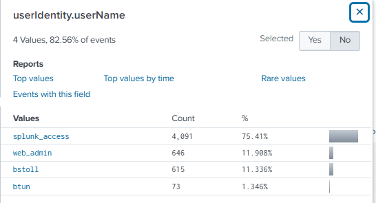

**Achado:** quatro contas IAM. `splunk_access` (75%) é a conta de serviço que o Splunk usa para buscar os logs; `web_admin`, `bstoll` e `btun` são pessoas. Os 17% sem usuário são ações da própria AWS (por exemplo, `autoscaling.amazonaws.com`).

</details>

<details>
<summary><b>02 · Quem usa MFA</b> <code>o mesmo problema do Office 365</code></summary>
<br>

```spl
index=botsv3 sourcetype=aws:cloudtrail
| stats count by userIdentity.userName userIdentity.sessionContext.attributes.mfaAuthenticated
```

> **Leitura:** quantas ações cada usuário fez com e sem verificação em duas etapas.

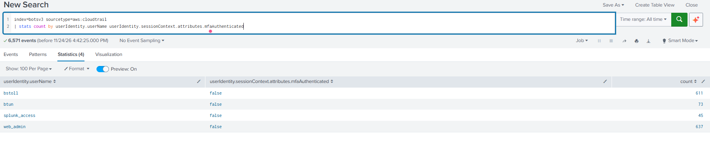

**Achado:** **`false` para todos.** O `splunk_access` aparece com só 45 ações porque o resto é feito por chave de acesso, sem sessão de login e sem esse campo.

</details>

<details>
<summary><b>03 · As ações mais raras</b> <code>o raro costuma ser o importante</code></summary>
<br>

```spl
index=botsv3 sourcetype=aws:cloudtrail userIdentity.userName!=splunk_access
| stats count by eventName
| sort count
```

> **Leitura:** os tipos de ação feitos pelas pessoas, das mais raras para as mais comuns.

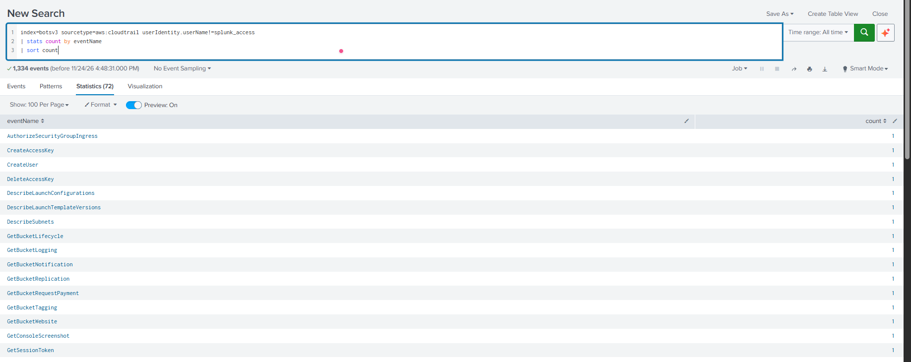

**Achado:** 72 tipos. No topo, ações de **mudança** (`AuthorizeSecurityGroupIngress`, `CreateUser`, `CreateAccessKey`, `DeleteAccessKey`) e muitas consultas a buckets (`GetBucket…`).

</details>

<details>
<summary><b>04 · Só as mudanças, em ordem</b> <code>verbos de escrita</code></summary>
<br>

No CloudTrail, `Describe`, `List` e `Get` só olham. `Put`, `Create`, `Delete`, `Authorize`, `Attach`, `Update` e `Modify` mudam algo.

```spl
index=botsv3 sourcetype=aws:cloudtrail userIdentity.userName!=splunk_access (eventName=Put* OR eventName=Create* OR eventName=Delete* OR eventName=Authorize* OR eventName=Attach* OR eventName=Update* OR eventName=Modify*)
| table _time userIdentity.userName eventName sourceIPAddress
| sort _time
```

> **Leitura:** em ordem, toda mudança feita na AWS, por quem e de qual IP.

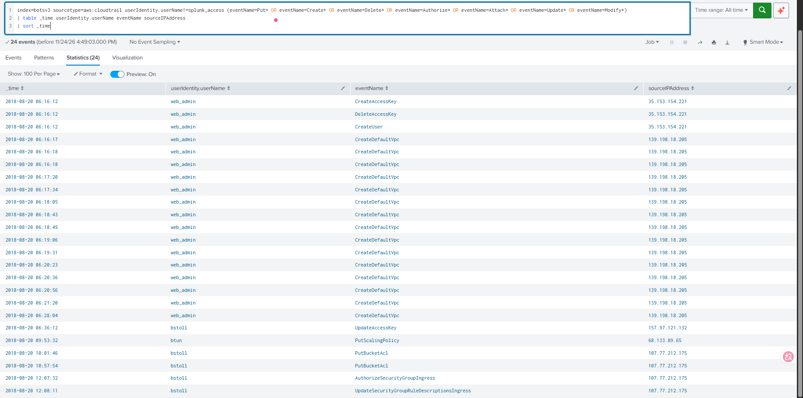

**Achado:** três grupos. **`web_admin`** com três ações no mesmo segundo (script) e 16 `CreateDefaultVpc`, vindo de **dois IPs diferentes** em cinco segundos. **`bstoll`** com duas `PutBucketAcl` com uma hora de intervalo e uma porta aberta num firewall. E duas ações avulsas de rotina.

</details>

<details>
<summary><b>05 · O que funcionou</b> <code>errorCode vazio = sucesso</code></summary>
<br>

```spl
index=botsv3 sourcetype=aws:cloudtrail userIdentity.userName!=splunk_access (eventName=Put* OR eventName=Create* OR eventName=Delete* OR eventName=Authorize* OR eventName=Attach* OR eventName=Update* OR eventName=Modify*)
| table _time userIdentity.userName eventName sourceIPAddress errorCode
| sort _time
```

> **Leitura:** a mesma lista, com o código de erro de cada ação.

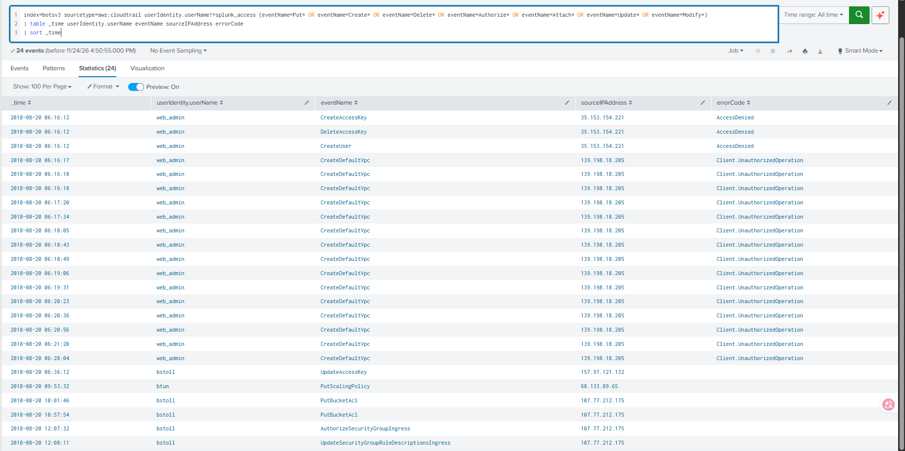

**Achado:** as **19 ações do `web_admin` foram negadas** (`AccessDenied` e `Client.UnauthorizedOperation`). O mínimo privilégio funcionou. Mas, para negar, a AWS precisa primeiro reconhecer quem pede: **a chave autenticou**. Origem estranha, script e tentativas típicas de invasor apontam para **chave vazada**. As ações do `bstoll` **funcionaram**.

</details>

<details>
<summary><b>06 · O que mudou no bucket</b> <code>AllUsers = a internet inteira</code></summary>
<br>

```spl
index=botsv3 sourcetype=aws:cloudtrail eventName=PutBucketAcl
| table _time requestParameters.bucketName requestParameters.AccessControlPolicy.AccessControlList.Grant{}.Grantee.URI requestParameters.AccessControlPolicy.AccessControlList.Grant{}.Permission
```

> **Leitura:** nas duas mudanças de permissão, qual bucket, para quem e com qual permissão.

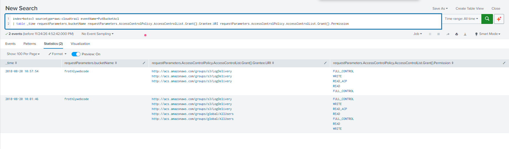

**Achado:** às **10:01:46**, o bucket **`frothlywebcode`** ganhou duas permissões para **`http://acs.amazonaws.com/groups/global/AllUsers`**: **`READ`** e **`WRITE`**. Às **10:57:54**, elas sumiram. A mudança foi feita pelo console (`userAgent: signin.amazonaws.com`), por uma conta legítima, e desfeita uma hora depois: tem cara de erro, não de ataque.

As colunas não ficam perfeitamente alinhadas: a primeira permissão (`FULL_CONTROL`) é do dono, identificado por ID e não por URI. As duas permissões extras do evento das 10:01 casam com as duas linhas de `AllUsers`.

</details>

<details>
<summary><b>07 · Onde ficam os acessos ao bucket</b> <code>conferir a fonte antes</code></summary>
<br>

```spl
index=botsv3 frothlywebcode earliest="08/20/2018:10:01:00" latest="08/20/2018:10:58:00"
| stats count by sourcetype
```

> **Leitura:** quais logs registraram movimentação no bucket durante os 56 minutos.

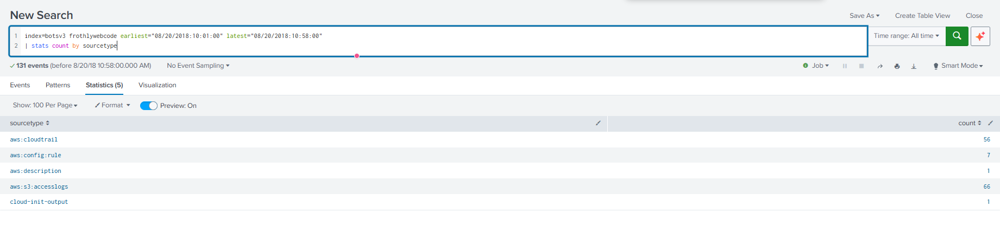

**Achado:** `aws:s3:accesslogs` (66 eventos) registra quem leu e gravou arquivos.

</details>

<details>
<summary><b>08 · Ler o log de acesso</b> <code>stats some com tudo se um campo não existe</code></summary>
<br>

Tentei `| stats count by operation key remote_ip http_status` e voltou **zero**: o `stats ... by` descarta o evento inteiro se qualquer um dos campos não existir. Fui ver os eventos crus:

```spl
index=botsv3 sourcetype=aws:s3:accesslogs frothlywebcode earliest="08/20/2018:10:01:00" latest="08/20/2018:10:58:00"
```

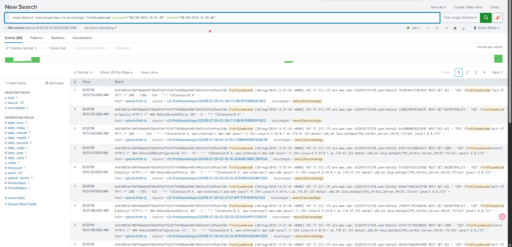

**Achado:** o log vem como **texto corrido**, sem campos extraídos. Cada linha segue a ordem: dono, bucket, `[hora]`, **IP**, **quem** (`arn:...:user/bstoll` ou **`-` para anônimo**), ID do pedido, **operação** (`REST.GET.OBJECT`, `REST.PUT.OBJECT`…), **arquivo**, pedido e **status HTTP**. A tela mostrava o próprio Bud conferindo e corrigindo as permissões às 10:57.

</details>

<details>
<summary><b>09 · Alguém gravou arquivo?</b> <code>buscar pela palavra quando não há campo</code></summary>
<br>

```spl
index=botsv3 sourcetype=aws:s3:accesslogs frothlywebcode REST.PUT.OBJECT earliest="08/20/2018:10:01:00" latest="08/20/2018:10:58:00"
```

> **Leitura:** as linhas em que alguém gravou um arquivo no bucket enquanto ele estava público.

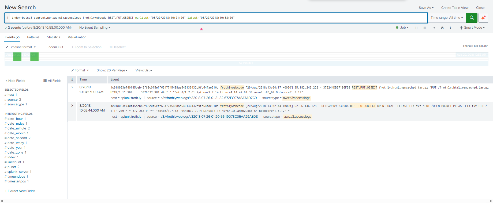

**Achado:** dois uploads **anônimos** (`-`), ambos com **status 200** e feitos com `Boto3/Python` (scripts):

| Hora | IP | Arquivo | Tamanho |
| :-- | :-- | :-- | :-- |
| 10:02:44 | 52.66.146.128 | `OPEN_BUCKET_PLEASE_FIX.txt` | 268 bytes |
| 10:04:17 | 35.182.246.222 | **`frothly_html_memcached.tar.gz`** | **~3 MB** |

O primeiro chegou **um minuto** depois da exposição: há robôs varrendo a internet atrás de buckets abertos. O recado tem cara de pesquisador avisando. O segundo é o problema.

</details>

<details>
<summary><b>10 e 11 · O pacote foi usado?</b> <code>do bucket para os servidores</code></summary>
<br>

```spl
index=botsv3 frothly_html_memcached
| stats count by sourcetype host
```

> **Leitura:** em quais logs e máquinas o nome do pacote aparece.

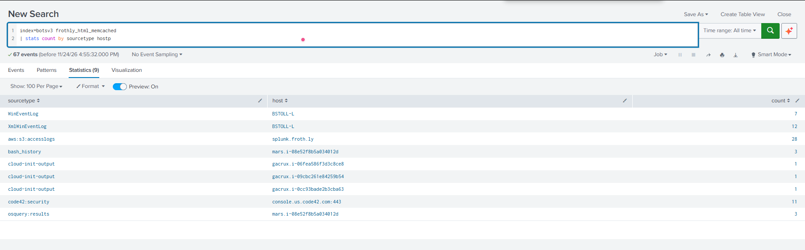

**Achado:** o nome aparece no `cloud-init-output` de três servidores `gacrux`, no `bash_history` e no `osquery` do servidor Linux `mars`, no notebook BSTOLL-L e no Code42.

```spl
index=botsv3 frothly_html_memcached (sourcetype=bash_history OR sourcetype=cloud-init-output)
| table _time host sourcetype _raw
| sort _time
```

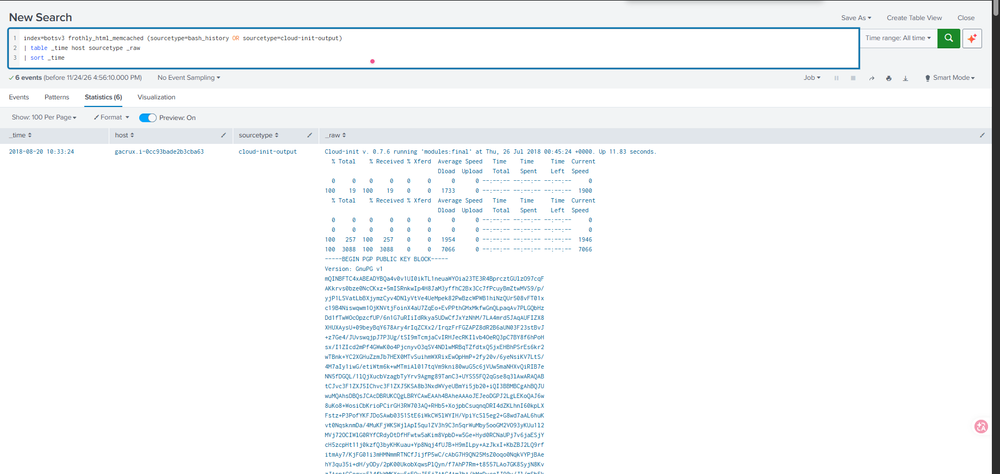

**Achado:** o `cloud-init` é o log de inicialização dos servidores, e o desse servidor registra um boot em **26 de julho de 2018**, quase um mês antes. Ou seja, **`frothly_html_memcached.tar.gz` é o pacote legítimo do site**, que os servidores baixam do bucket ao iniciar. O upload anônimo das 10:04 **substituiu o pacote verdadeiro** por uma versão de origem desconhecida, com o mesmo nome.

</details>

## `$ cat conclusao.md`

**Resposta ao chamado:**

- **Quem acessou:** `web_admin`, `bstoll`, `btun` e a conta de serviço `splunk_access`.
- **MFA:** nenhuma das quatro contas usa.
- **Tentativa suspeita:** a chave do `web_admin` foi usada de fora por um script, tentando criar usuário, chaves e redes. Tudo foi negado, mas a chave autentica e provavelmente vazou.
- **Exposição:** por um erro de configuração no console, o bucket `frothlywebcode` (código do site) ficou **público para leitura e escrita por 56 minutos**.
- **Consequência:** em um minuto, robôs encontraram o bucket. Um deixou um recado; outro **substituiu o pacote de instalação do site**, que os servidores baixam ao iniciar.

**Relação com o ataque dos casos 02 a 04:** nenhuma encontrada. Os IPs são diferentes e o padrão é de varredura automática da internet, não de ataque direcionado.

**O que os logs não mostram:** o conteúdo da versão anônima do pacote, se algum servidor iniciou com ela depois das 10:04 e onde a chave do `web_admin` vazou.

| Técnica | Nome | Como apareceu |
| :-- | :-- | :-- |
| [T1078.004](https://attack.mitre.org/techniques/T1078/004/) | Valid Accounts: Cloud Accounts | Chave do `web_admin` usada de IPs externos |
| [T1578](https://attack.mitre.org/techniques/T1578/) | Modify Cloud Compute Infrastructure | Tentativas de criar VPCs (negadas) |
| [T1530](https://attack.mitre.org/techniques/T1530/) | Data from Cloud Storage | Bucket do código do site legível por qualquer pessoa |
| [T1565.001](https://attack.mitre.org/techniques/T1565/001/) | Data Manipulation: Stored Data Manipulation | Pacote do site substituído por upload anônimo |

**IOCs:**

| Tipo | Valor |
| :-- | :-- |
| IPs que usaram a chave do `web_admin` | `35.153.154.221` · `139.198.18.205` |
| IPs dos uploads anônimos | `52.66.146.128` · `35.182.246.222` |
| Arquivos gravados | `OPEN_BUCKET_PLEASE_FIX.txt` · `frothly_html_memcached.tar.gz` (versão de 10:04:17) |
| Bucket | `frothlywebcode` |

## `$ ./escalar --para N2`

- [ ] **Restaurar o pacote legítimo** `frothly_html_memcached.tar.gz` e **analisar a versão anônima** em ambiente isolado
- [ ] **Verificar os servidores iniciados depois das 10:04** e o comando registrado no `bash_history` do `mars`
- [ ] **Revogar a chave do `web_admin`** e descobrir onde ela vazou
- [ ] **Exigir MFA** nas quatro contas
- [ ] **Ativar o *S3 Block Public Access*** na conta inteira
- [ ] **Alertar** para `PutBucketAcl` ou políticas com `AllUsers` / `AuthenticatedUsers`
- [ ] **Revisar a regra de firewall** aberta pelo `bstoll` às 12:07
- [ ] **Ativar versionamento** no bucket, para poder voltar a uma versão anterior de cada arquivo

---

<div align="center">

[← voltar para os casos](../README.md) · [queries deste caso](queries.spl)

</div>
