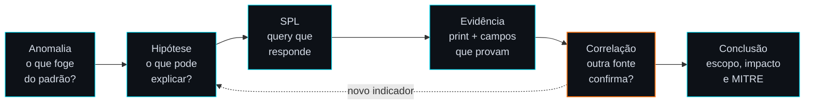

<div align="center">



<br>


<br>


**Investigações de segurança no dataset [Boss of the SOC v3](https://github.com/splunk/botsv3) da Splunk,**<br>
**do primeiro sinal de anomalia até a conclusão documentada.**

</div>

---

```console
analista@soc:~$ cat caso.txt
> AMBIENTE ..... Frothly, cervejaria fictícia (Windows, Linux, AWS, Office 365, firewall, antivírus)
> DATASET ...... Splunk BOTS v3 · 2 milhões de eventos · 102 fontes
> PAPEL ........ Analista de SOC N1 de plantão
> MISSÃO ....... descobrir o que aconteceu, onde, com quem e quando, e documentar
> STATUS ....... ███████░░░░░░░░░░░░░░░ caso 01 de 03 resolvido
```

## `$ whoami`

Este repositório simula o trabalho de um **Analista de SOC N1**: partir de uma anomalia, levantar hipóteses, escrever SPL, **correlacionar fontes diferentes** e fechar cada caso com evidência, escopo, conclusão e mapeamento no **MITRE ATT&CK**.

Cada passo explica **por que** foi dado e **como se liga ao anterior**. O objetivo é mostrar o raciocínio, não só as queries.

## `$ ls ./casos`

| # | Caso | Fontes correlacionadas | MITRE ATT&CK | Status |
| :-: | :-- | :-- | :-- | :-: |
| 01 | **[Cryptojacking via Coinhive em fórum externo](01-cryptojacking-coinhive/)**<br><sub>Uma anomalia de volume de logs leva a um minerador de Monero rodando no navegador de 3 notebooks</sub> | Perfmon · DNS · HTTP · syslog · Symantec | T1189 · T1496 |  |
| 02 | Investigação com foco em DNS | — | — |  |
| 03 | Investigação com foco em HTTP | — | — |  |

## `$ ./investigar --metodo`



Todo caso tem: **resumo**, **linha do tempo**, **investigação passo a passo** (query + explicação + leitura em português + print) e **recomendações** de N1 para N2.

## `$ cat ./lab/ambiente.conf`

| Componente | Detalhe |
| :-- | :-- |
| **SIEM** | Splunk Enterprise 10.4.3, local no Windows, licença Free |
| **Dataset** | BOTS v3 pré-indexado: 2.083.056 eventos, 102 sourcetypes |
| **Add-ons** | Microsoft Windows · Sysmon · Stream Wire Data |
| **Montagem** | Passo a passo, com os problemas encontrados e as soluções: **[setup.md](setup.md)** |

## `$ cat ./sobre-o-processo.md`

As investigações foram executadas por mim no meu laboratório local. Usei o Claude (IA) como mentor durante o estudo: para explicar comandos SPL, discutir hipóteses e revisar a documentação. Todas as queries foram rodadas e todos os resultados foram analisados e validados por mim.

---

<div align="center">

Desenvolvido por **[Vinicius Henrique (AhiPy)](https://github.com/AhiPy)**, Analista de Cibersegurança (Trainee) com foco em SOC N1

<a href="https://www.linkedin.com/in/vinicius-henrique-dev/"></a>

```text
[ sessão encerrada · dataset público da Splunk · nenhum sistema real foi tocado ]
```

</div>
