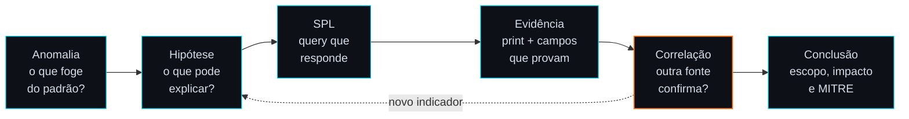

<div align="center">



<br>


<br>


**Investigações de segurança no dataset [Boss of the SOC v3](https://github.com/splunk/botsv3) da Splunk,**<br>
**do primeiro sinal de anomalia até a conclusão documentada.**

</div>

---

```console
analista@soc:~$ cat caso.txt
> AMBIENTE ..... Frothly, cervejaria fictícia (Windows, Linux, AWS, Office 365, firewall, antivírus)
> DATASET ...... Splunk BOTS v3 · 2 milhões de eventos · 102 fontes
> PAPEL ........ Analista de SOC N1 de plantão
> MISSÃO ....... descobrir o que aconteceu, onde, com quem e quando, e documentar
> STATUS ....... █████████████░░░░░░░░░ 3 de 5 casos resolvidos
```

## `$ whoami`

Este repositório simula o trabalho de um **Analista de SOC N1**: partir de uma anomalia, levantar hipóteses, escrever SPL, **correlacionar fontes diferentes** e fechar cada caso com evidência, escopo, conclusão e mapeamento no **MITRE ATT&CK**.

Cada passo explica **por que** foi dado e **como se liga ao anterior**. O objetivo é mostrar o raciocínio, não só as queries. Quando uma busca deu errado, deixei registrado também: errar o nome de um campo e entender por quê faz parte do trabalho.

> [!TIP]
> **Versão para gestão:** o [Relatório de Incidentes](RELATORIO.md) resume os casos sem jargão técnico, com a situação atual, o impacto para o negócio, gráficos e as ações recomendadas em ordem de prioridade. É atualizado a cada caso concluído.

## `$ cat historia.txt`

O BOTS v3 é um ambiente só, com vários incidentes acontecendo no mesmo dia (20/08/2018):

- **A empresa:** a Frothly, fornecedora de produtos para cerveja caseira. Quase todo nome no cenário é trocadilho com cerveja.
- **O enredo principal:** o FBI avisa a CEO, **Grace Hoppy**, que a empresa foi invadida pelo **Taedonggang**, um grupo APT do leste asiático que ataca cervejarias ocidentais. Os casos 02 em diante seguem esse fio.
- **Incidentes paralelos:** o caso 01 (Coinhive) não tem ligação com o APT. É um problema real que aconteceu no mesmo dia.
- **Nuvem:** a Frothly também tem problemas de configuração na AWS, investigados à parte.

## `$ ls ./casos`

| # | Caso | Fontes correlacionadas | MITRE ATT&CK | Status |
| :-: | :-- | :-- | :-- | :-: |
| 01 | **[Cryptojacking via Coinhive em fórum externo](01-cryptojacking-coinhive/)**<br><sub>Uma anomalia de volume de logs leva a um minerador de Monero rodando no navegador de 3 notebooks</sub> | Perfmon · DNS · HTTP · syslog · Symantec | T1189 · T1496 |  |
| 02 | **[Phishing com macro e contas comprometidas](02-phishing-contas-comprometidas/)**<br><sub>O phishing do APT foi barrado, mas veio de dentro: o mesmo IP de Hong Kong tinha login válido em duas contas da empresa</sub> | SMTP · Office 365 · Sysmon · antivírus · Azure AD | T1566.001 · T1078.004 |  |
| 03 | **[O que o atacante fez dentro do Office 365](03-office365-persistencia/)**<br><sub>Uma isca no OneDrive, uma busca em todos os e-mails e uma regra que continuava copiando e-mails para fora mesmo depois da troca de senha</sub> | Auditoria do Office 365 | T1080 · T1114 · T1098 |  |
| 04 | O atalho `.lnk` nos 7 laptops: alguém executou? | — | — |  |
| 05 | Auditoria da conta AWS (CloudTrail) | — | — |  |

## `$ ./investigar --metodo`



Todo caso tem: **resumo**, **linha do tempo**, **investigação passo a passo** (query + explicação + leitura em português + print) e **recomendações** de N1 para N2.

## `$ cat ./lab/ambiente.conf`

| Componente | Detalhe |
| :-- | :-- |
| **SIEM** | Splunk Enterprise 10.4.3, local no Windows, licença Free |
| **Dataset** | BOTS v3 pré-indexado: 2.083.056 eventos, 102 sourcetypes |
| **Add-ons** | Microsoft Windows · Sysmon · Stream Wire Data |
| **Montagem** | Passo a passo, com os problemas encontrados e as soluções: **[setup.md](setup.md)** |

## `$ cat ./sobre-o-processo.md`

Este é um projeto de estudo, e quero ser transparente sobre como ele foi feito.

- **O que é meu:** montei o laboratório, rodei todas as queries no meu Splunk, li os resultados, levantei as hipóteses e tirei os prints. Nenhum resultado aqui foi inventado ou copiado de writeups.
- **Onde a IA entrou:** usei o **Claude** (Anthropic) como mentor durante as investigações, para explicar comandos SPL e campos de log, discutir hipóteses e apontar quando eu estava indo pelo caminho errado. Ele também me ajudou a redigir e organizar os READMEs a partir das minhas anotações e prints. Revisei todo o texto antes de publicar.
- **Por que conto isso:** usar IA como apoio de estudo é parte de como trabalho hoje, e prefiro que fique claro o que eu sei fazer sozinho e onde tive ajuda.

Os commits feitos com apoio da IA levam a linha `Co-Authored-By` correspondente.

---

<div align="center">

Desenvolvido por **[Vinicius Henrique (AhiPy)](https://github.com/AhiPy)**, Analista de Segurança da Informação Júnior com foco em SOC N1

<a href="https://www.linkedin.com/in/vinicius-henrique-dev/"></a>

```text
[ sessão encerrada · dataset público da Splunk · nenhum sistema real foi tocado ]
```

</div>
