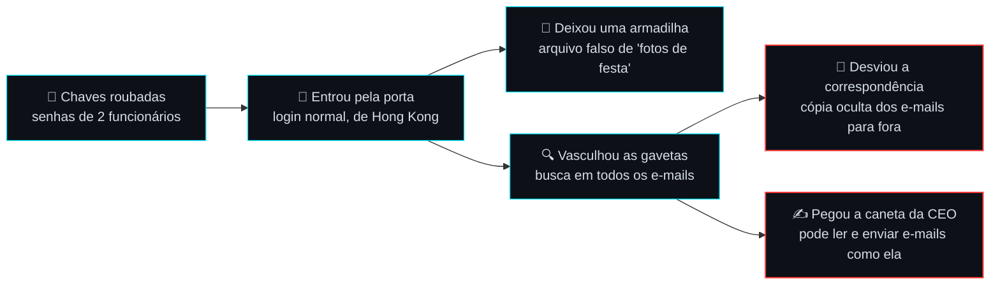
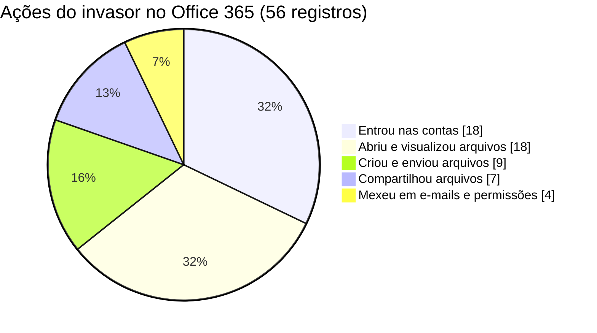

# Relatório Executivo de Incidentes de Segurança

**Frothly · 20 de agosto de 2018**

> [!NOTE]
> **Documento de estudo.** A Frothly é uma empresa fictícia do dataset público [Splunk Boss of the SOC v3](https://github.com/splunk/botsv3). Nenhum sistema real foi analisado. O objetivo é praticar o que um analista de SOC entrega à gestão depois de uma investigação: **o que aconteceu, o que isso significa para a empresa e o que precisa ser decidido.**
>
> Este relatório é atualizado a cada caso concluído. Os detalhes técnicos de cada investigação estão nos links da [seção 8](#8-detalhe-de-cada-caso).

---

## 1. Resumo em 30 segundos

**A Frothly foi invadida por um grupo criminoso organizado, e o invasor ainda recebe cópias dos nossos e-mails.**

- O invasor **entrou com senhas válidas de dois funcionários**: não precisou "arrombar" nada.
- Ele **procurou informações financeiras e confidenciais em todos os e-mails da empresa**.
- Ele **criou uma regra no servidor de e-mail que envia cópias escondidas para um endereço externo**. Essa regra **continua funcionando mesmo se as senhas forem trocadas**.
- Ele **ganhou permissão para ler e enviar e-mails em nome da CEO**, o que abre caminho para fraudes.
- Ele **espalhou um arquivo malicioso disfarçado de "fotos de festa"** que chegou a **7 computadores**. Ainda estamos verificando se alguém o abriu.

> [!CAUTION]
> **Decisão necessária hoje:** autorizar a remoção imediata da regra de e-mail e das permissões na caixa da CEO, e a troca de senhas com verificação em duas etapas. Enquanto a regra existir, **os e-mails continuam saindo da empresa**.

## 2. Situação atual

| Área | Situação | O que significa | Status |
| :-- | :-- | :-- | :-: |
| **E-mail corporativo** | Regra copiando e-mails para fora | Informação confidencial saindo da empresa **agora** | 🔴 Ativo |
| **Caixa de e-mail da CEO** | Acesso total e envio em nome dela liberados para conta comprometida | Risco de leitura de assuntos sigilosos e de **fraude por e-mail falso da CEO** | 🔴 Ativo |
| **Contas de funcionários** | 2 contas usadas pelo invasor, sem verificação em duas etapas | Porta de entrada ainda aberta em uma delas | 🟠 Parcial (1 de 2 desativada) |
| **Computadores** | Arquivo malicioso chegou a 7 notebooks | Possível invasão dos computadores | 🟡 Em investigação |
| **Ataque por anexo de e-mail** | Planilha maliciosa enviada à diretoria | Bloqueada pelo filtro de e-mail e pelo antivírus | 🟢 Contido |
| **Minerador de criptomoeda** | Site externo usou a CPU de notebooks | Incidente isolado, sem roubo de dados | 🟢 Encerrado |

## 3. Como o ataque aconteceu

Em linguagem simples, como se fosse a invasão de um escritório:

1. **As chaves já estavam com o invasor.** Ele entrou nas contas de **Bruce Gist** e **Fyodor Malteskesko** com a senha correta, a partir de **Hong Kong**. Como as contas não pediam verificação em duas etapas, a senha bastou. Ainda não sabemos como as senhas vazaram.
2. **Tentou enganar a diretoria por e-mail.** Usando a conta do Bruce, enviou uma planilha de "plano financeiro" com código malicioso para quatro pessoas, incluindo a CEO. **O filtro de e-mail e o antivírus bloquearam.**
3. **Deixou uma armadilha mais esperta.** No OneDrive do próprio Bruce, colocou um atalho chamado *"Fotos do happy hour de aniversário do Bruce"*, escondido entre fotos de cerveja, e criou um link público para ele. Como veio de dentro da empresa, **não passou por nenhum filtro** e chegou a 7 computadores.
4. **Vasculhou os e-mails de todos.** Com a conta do Fyodor, que tem permissões de administrador, buscou em **todas** as caixas de e-mail por palavras como *"financial"*, *"secret"* e *"cromdale"*.
5. **Garantiu que continuaria recebendo informação.** Criou uma regra que envia **cópia oculta dos e-mails** para `hyunki1984@naver.com` e deu à conta do Fyodor acesso total à caixa da CEO, incluindo **enviar e-mails como se fosse ela**.
6. **Avisou que estava lá.** Ao meio-dia, o mesmo endereço externo mandou à CEO um e-mail dizendo *"todos os seus dados nos pertencem"*.

## 4. Linha do tempo do dia

```mermaid
gantt
    title 20/08/2018 (horário de Brasília)
    dateFormat HH:mm
    axisFormat %H:%M

    section Ataque principal
    Phishing com planilha maliciosa (bloqueado)    :milestone, m1, 06:55, 0m
    Armadilha no OneDrive + link público           :crit, a1, 06:56, 2m
    Arquivo chega a 7 computadores                 :crit, a2, 06:59, 3m
    Logins de Hong Kong                            :a3, 07:47, 23m
    Busca em todos os e-mails                      :crit, milestone, m2, 07:48, 0m
    Acesso à caixa da CEO                          :crit, milestone, m3, 08:10, 0m
    Regra de cópia oculta dos e-mails              :crit, milestone, m4, 08:21, 0m
    Conta do Bruce desativada                      :milestone, m5, 11:47, 0m
    E-mail de ameaça à CEO                         :milestone, m6, 12:15, 0m

    section Incidente paralelo
    Minerador de criptomoeda em notebooks          :c1, 10:20, 50m
```

Entre a primeira ação do invasor e o e-mail de ameaça passaram-se cerca de **5 horas**. As ações mais graves aconteceram em **menos de 1h30** (das 06:55 às 08:21).

## 5. O que o invasor fez, em números

O número que mais importa é o **menor**: as 4 ações sobre e-mails e permissões, mais a regra de cópia criada de outro endereço, são as que mantêm o invasor dentro da empresa.

| Indicador | Valor |
| :-- | :-: |
| Contas de funcionários comprometidas | **2** |
| Endereços de internet usados pelo invasor | **2** (Hong Kong) |
| Computadores que receberam o arquivo malicioso | **7** |
| Caixas de e-mail vasculhadas | **todas** |
| Tentativas de ataque bloqueadas automaticamente | **2** (filtro de e-mail e antivírus) |
| Formas de acesso persistente criadas | **3** (regra de e-mail, acesso total e envio em nome da CEO) |

## 6. Impacto para o negócio

| Risco | Por que importa | Probabilidade |
| :-- | :-- | :-: |
| **Vazamento de informação confidencial** | E-mails financeiros e estratégicos podem estar com o invasor e com terceiros | Alta |
| **Fraude em nome da CEO** | Um pedido de pagamento "assinado" pela CEO, vindo da caixa real dela, é muito difícil de identificar | Alta |
| **Invasão dos computadores** | Se alguém abriu o arquivo, o invasor passa a controlar máquinas da rede interna | Em investigação |
| **Reputação e obrigações legais** | Dependendo do que vazou, pode haver dever de comunicar clientes, parceiros ou autoridades | A avaliar |

## 7. Ações recomendadas

Em ordem de prioridade.

| # | Ação | Por quê | Responsável sugerido | Prazo | Status |
| :-: | :-- | :-- | :-- | :-- | :-: |
| 1 | **Apagar a regra de e-mail "SOX"** | Interrompe o vazamento contínuo | TI / Segurança | **Imediato** | ⬜ |
| 2 | **Remover os acessos extras à caixa da CEO** | Impede leitura e fraude em nome dela | TI / Segurança | **Imediato** | ⬜ |
| 3 | **Trocar a senha do Fyodor e encerrar as sessões abertas** | Fecha a porta ainda aberta | TI | **Imediato** | ⬜ |
| 4 | **Bloquear os endereços do invasor** | Dificulta o retorno | Segurança | **Imediato** | ⬜ |
| 5 | **Apagar o arquivo malicioso e o link público** | Evita novas vítimas | TI | 24 horas | ⬜ |
| 6 | **Exigir verificação em duas etapas para todos** | Senha roubada deixa de ser suficiente | TI + Diretoria | 7 dias | ⬜ |
| 7 | **Alertar a CEO e o financeiro** | Desconfiar de pedidos urgentes por e-mail, mesmo vindos da CEO | Diretoria | Imediato | ⬜ |
| 8 | **Revisar quem precisa ser administrador** | A conta mais perigosa era a com mais poder | TI | 7 dias | ⬜ |
| 9 | **Criar alertas para novas regras e permissões de e-mail** | Detectar a próxima tentativa em minutos, não em horas | Segurança | 30 dias | ⬜ |
| 10 | **Concluir a análise dos 7 computadores** | Saber se o invasor também está na rede interna | Segurança | Em andamento | 🟡 |

> [!TIP]
> **O que já funcionou bem:** o filtro de e-mail e o antivírus bloquearam a planilha maliciosa, e a conta do Bruce foi desativada no fim da manhã. O problema é que o invasor **não dependia só do e-mail**: usou contas legítimas, e isso nenhum filtro barra.

## 8. Detalhe de cada caso

| # | Caso | Em uma frase | Gravidade | Status |
| :-: | :-- | :-- | :-: | :-: |
| 01 | [Minerador de criptomoeda](01-cryptojacking-coinhive/) | Um fórum externo usou a CPU de notebooks para minerar criptomoeda; sem roubo de dados | 🟡 Média | 🟢 Encerrado |
| 02 | [Phishing e contas comprometidas](02-phishing-contas-comprometidas/) | A planilha maliciosa foi bloqueada, mas revelou que o invasor já tinha as senhas de duas contas | 🔴 Alta | 🟢 Concluído |
| 03 | [O que o invasor fez no Office 365](03-office365-persistencia/) | Armadilha no OneDrive, busca em todos os e-mails e regra de cópia oculta para fora | 🔴 Crítica | 🟢 Concluído |
| 04 | O arquivo nos 7 computadores | Alguém abriu o atalho? O invasor chegou à rede interna? | — | 🟡 Próximo |
| 05 | Nuvem da Amazon (AWS) | Problemas de configuração na infraestrutura em nuvem, independentes deste ataque | — | ⬜ Planejado |

## 9. O que vem a seguir

- **Caso 04, computadores:** verificar nos 7 notebooks se o atalho foi **apenas sincronizado** ou **executado**. Um dos notebooks (do Bud Stoll) teve uma segunda atividade às 08:28, que é o primeiro ponto a examinar. Se houve execução, o próximo passo é descobrir o que o invasor fez dentro da rede.
- **Caso 05, AWS:** auditoria da conta de nuvem da empresa: quem acessou, com ou sem verificação em duas etapas, e se algum dado ficou exposto publicamente.

Este relatório será atualizado ao final de cada caso, com a situação e as recomendações revisadas.

## 10. Glossário rápido

| Termo | Em português simples |
| :-- | :-- |
| **APT** | Grupo de invasores organizado e persistente, que ataca um alvo específico com um objetivo |
| **Phishing** | E-mail falso feito para enganar alguém a abrir um arquivo ou entregar uma senha |
| **Conta comprometida** | Conta de funcionário que está sendo usada por outra pessoa |
| **Verificação em duas etapas (MFA)** | Além da senha, um código no celular. Sem ele, a senha roubada não basta |
| **Persistência** | Qualquer truque para o invasor continuar com acesso depois de ser descoberto |
| **Regra de transporte** | Regra no servidor de e-mail que copia ou redireciona mensagens automaticamente |
| **Atalho `.lnk`** | Arquivo de atalho do Windows; parece inofensivo, mas pode executar comandos |
| **IOC** | "Pista" concreta do ataque: endereço de internet, nome de arquivo, e-mail do invasor |
| **SOC** | Equipe que monitora a segurança da empresa e responde a incidentes |
| **Contenção** | Ações para parar o estrago enquanto a investigação continua |

## 11. Sobre este documento

| | |
| :-- | :-- |
| **Investigação e análise** | [Vinicius Henrique (AhiPy)](https://github.com/AhiPy), Analista de Segurança da Informação Júnior com foco em SOC N1 |
| **Redação** | Elaborado com apoio do **Claude** (Anthropic), a partir das investigações, anotações e evidências do autor. Todas as conclusões foram revisadas por ele. |
| **Base técnica** | Investigações em SPL no Splunk Enterprise, documentadas neste repositório |
| **Fonte dos dados** | Dataset público Splunk BOTS v3 (empresa e pessoas fictícias) |

**Histórico de versões**

| Versão | Data | Alteração |
| :-- | :-- | :-- |
| 1.0 | 24/11/2026 | Primeira versão: casos 01, 02 e 03 |

---

[← voltar para os casos](README.md)

