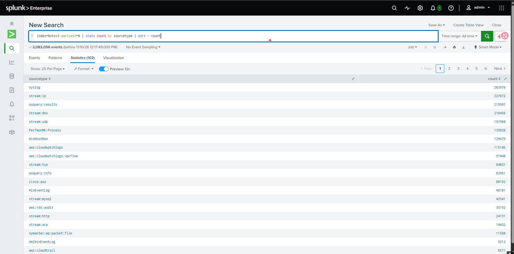
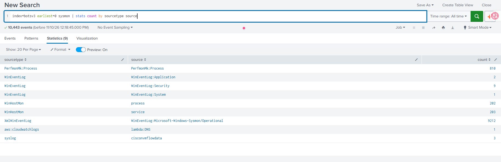

# Montagem do laboratório

Como o ambiente de investigação foi montado num Splunk Enterprise local (Windows).

## 1. Dataset

- Download: [botsv3_data_set.tgz](https://botsdataset.s3.amazonaws.com/botsv3/botsv3_data_set.tgz) (320,1 MB, pré-indexado)
- Integridade conferida antes da instalação:

```powershell
certutil -hashfile botsv3_data_set.tgz MD5
# esperado: d7ccca99a01cff070dff3c139cdc10eb
```

## 2. Instalação

```powershell
& "C:\Program Files\Splunk\bin\splunk.exe" stop
tar -xzf "$HOME\Downloads\botsv3_data_set.tgz" -C "C:\Program Files\Splunk\etc\apps"
& "C:\Program Files\Splunk\bin\splunk.exe" start
```

Na inicialização, o Splunk validou o índice `botsv3` e emitiu um aviso:

```
botsv3_data_set\default\props.conf, line 102: Cannot parse into key-value pair: EXTRACT-src ^(?<src_ip>[^s]+)
```

É uma linha malformada na configuração original do dataset (2018). O Splunk 10.4 apenas ignora essa regra. Não afeta as investigações.

## 3. Add-ons

O README oficial pede Splunk 7.1.7 e 26 add-ons em versões exatas, muitos deles descontinuados. Foram instaladas as versões atuais dos add-ons necessários para o foco do estudo:

| Add-on | Para quê |
| --- | --- |
| Splunk Add-on for Microsoft Windows | Campos do `WinEventLog` |
| Splunk Add-on for Sysmon | Campos do Sysmon (`XmlWinEventLog`) |
| Splunk Add-on for Stream Wire Data | Campos do `stream:dns` e `stream:http` |

Instalação via **Apps → Manage Apps → Install app from file**, com os pacotes baixados do Splunkbase.

## 4. Problemas encontrados

| Problema | Causa | Solução |
| --- | --- | --- |
| Login do Splunkbase falhou na instalação pela interface | Login interno não aceita a conta | Download manual no Splunkbase + *Install app from file* |
| Buscas bloqueadas: *"Your Splunk license expired"* | Licença Trial de 60 dias vencida | Troca para **Free license** (Settings → Licensing). O dataset é pré-indexado e não conta no limite de 500 MB/dia |
| Sysmon não encontrado pelo sourcetype do README | O add-on atual usa outro nome | Sysmon está em `sourcetype=XmlWinEventLog`, `source="WinEventLog:Microsoft-Windows-Sysmon/Operational"` |

## 5. Validação

```spl
index=botsv3 earliest=0
| stats count by sourcetype
| sort - count
```

Resultado: **2.083.056 eventos** em **102 sourcetypes**.



Localização do Sysmon:

```spl
index=botsv3 earliest=0 sysmon
| stats count by sourcetype source
```


